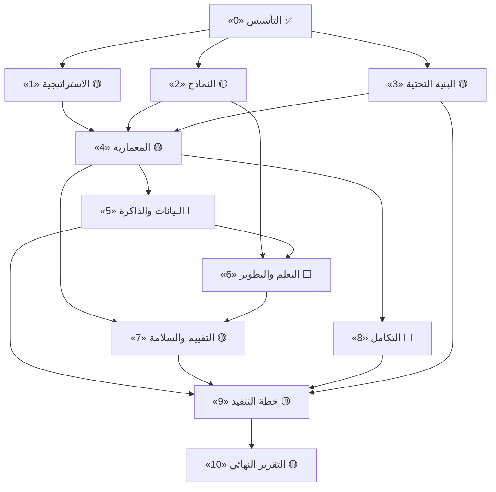

# MASTER_ROADMAP — الخطة الرئيسية

> إصدار: v1.1 · تاريخ: 2026-11-22 · مرجع التبعيات المعتمد
> كل مرحلة موثقة تفصيلًا في `docs/NN-*/phase-NN.md` — هذا الملف هو الخريطة والفهرس فقط.
> **طبقة التنفيذ النشطة:** المسار الصفري المعتمد بأمر المالك (ADR-0006) — خطة F0–F5 تعمل داخل هذه المراحل بلا تكاليف (خريطة الربط: `ZERO_COST_PLAN.md` §7). السيناريوهات المدفوعة في COST_MODEL §4 تبقى أبوابًا مستقبلية.

## 1. خريطة التبعيات

**قاعدة التبعية (ملزمة):** لا تبدأ مرحلة قبل اكتمال مخرجات تبعياتها المعرفة في ملفها. الاستثناءات الموثقة: بناء مجموعات الاختبار (7) يبدأ مبكرًا بالتوازي لأنها شرط لأي تقييم لاحق.

## 2. جدول المراحل

| المرحلة | الملف | المخرج الرئيسي | معيار النجاح المركزي | الحالة |
|---|---|---|---|---|
| 0 — التأسيس وفحص الواقع | `docs/00-foundation/phase-00.md` | مستودع + `ALKEMOS_BASELINE.md` + فحص AWS | كل حقائق الخط الأساس مُقاسة من الكود ومؤرخة | ✅ منجزة 2026-11-22 |
| 1 — الاستراتيجية والجدوى | `docs/01-strategy/phase-01.md` | قرار مسار معتمد + نقطة تعادل محسوبة بأرقام استخدام حقيقية | مقارنة المسارات الثلاثة بأرقام قابلة للدفاع + قرار مالك | 🟡 مبدوءة (الإطار جاهز، تنقص أحجام الاستخدام) |
| 2 — دراسة النماذج المفتوحة | `docs/02-models/phase-02.md` | قائمة قصيرة مرتبة + بدائل احتياطية | تقييم عملي ثنائي اللغة لـ 3–5 مرشحين على مهامنا الحقيقية | 🟡 فرز أولي منجز (`initial-screening.md`) |
| 3 — التشغيل والبنية التحتية | `docs/03-infrastructure/phase-03.md` | قرار استضافة معتمد قابل للنقل | تشغيل مرجعي لخدمة استدلال ذاتي بسعر/جودة مقبولين | 🟡 فحص AWS منجز (`aws-audit.md`) |
| 4 — المعمارية التقنية | `docs/04-architecture/phase-04.md` | تصميم المحرك والعقود والواجهة الموحدة | وثيقة معمارية كاملة يعتمدها المالك وتصلح للتقسيم لمهام | 🟡 تصميم v0.1 |
| 5 — البيانات والمعرفة والذاكرة | `docs/05-data-memory/phase-05.md` | قاعدة معرفة أولى + تصميم ذاكرة قابلة للنقل | نواة معرفة علمية مُراجعة (رياضة/تغذية) + مخطط ذاكرة مُعتمد | ⬜ مخططة |
| 6 — التعلم والتطوير | `docs/06-training/phase-06.md` | استراتيجية تدريب + أول LoRA تجريبي | أول ضبط دقيق يمر مجموعة التقييم دون انحدار | ⬜ مخططة |
| 7 — التقييم والسلامة | `docs/07-evaluation-safety/phase-07.md` | مجموعتا اختبار AR/EN + بروتوكول سلامة صحية | بطارية تُشغَّل آليًا قبل أي تبديل نموذج | 🟡 تصميم v0.1 |
| 8 — التكامل مع Alkemos وEVO | `docs/08-integration/phase-08.md` | وضع ظل يعمل بالتوازي بلا مخاطرة إنتاج | تمرير حركة مرآتية بمقارنة مخرجات دون أي أثر على المستخدم | ⬜ مخططة |
| 9 — خطة التنفيذ والاستقلال | `docs/09-execution/phase-09.md` | خطة تنفيذ بميزانيات ومؤشرات وشروط توقف | خطة قابلة للتحويل مباشرة لمهام وكلاء البرمجة | 🟡 هيكل + سيناريوهات ميزانية |
| 10 — التقرير التأسيسي النهائي | `docs/10-final-report/phase-10.md` | التقرير الجامع المعتمد | تقرير يجيب عن كل أسئلة المالك العشرة ويحمل قرارات جاهزة | 🟡 v0.1 |

## 3. مبادئ التنفيذ عبر المراحل

1. **موجة واحدة لكل دفعة:** بعد كل مرحلة/دفعة إنجاز: مراجعة اتساق ← تسجيل القرارات في ADR ← تحديث `STATE.md` ← commit/push إلى `main`.
2. **أبحاث مستقلة تعمل بالتوازي** عند وجود فائدة حقيقية (مثل 2 و3 بعد اكتمال 0).
3. **الأدلة قبل الاعتماد:** لا نموذج يُعتمد لمهمة دون اختبار على المهمة نفسها (قانون خط الأساس «لا إدخال بلا دليل»).
4. **قابلية التراجع أولًا:** كل تصميم يحمل مسار عودة معلن (نمط `AI_ROUTER_MODE=legacy` في خط الأساس).
5. **المالك يقرر:** كل نقطة إنفاق أو مساس بالإنتاج تُرفع لقرار موثق — لا ينتظر البحث والتخطيط قرارات تنفيذ مستقبلية.

## 4. نقاط الفحص الكبرى (Gates)

- **G1 (نهاية 1+2+3):** اعتماد المسار + القائمة القصيرة للنماذج + الاستضافة ← **قرار مالك مطلوب**.
- **G2 (نهاية 4):** اعتماد المعمارية ← بعده يبدأ البناء الفعلي.
- **G3 (نهاية 7 المبكرة):** بطارية التقييم جاهزة ← شرط أي تشغيل ذاتي إنتاجي.
- **G4 (نهاية 8):** وضع الظل يثبت التعادل ← بعده تفعيل أول مهمة ذاتية تدريجيًا.
- **G5 (بعد 6 أشهر من G4):** مراجعة نسبة الحصة الذاتية وقرار التوسع نحو L3/L4.

