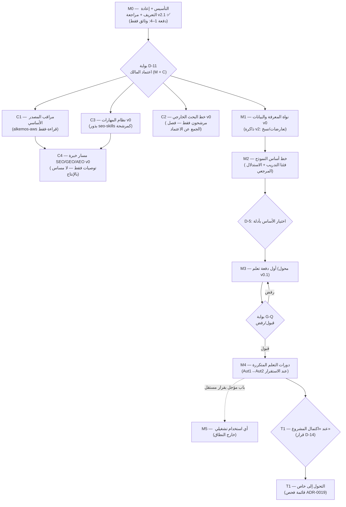

# MASTER_ROADMAP — خارطة الطريق (v2.1)

> إصدار: v2.1.1 · تاريخ: 2026-11-21 (UTC) (دفعة 5 — تحديث صف T1 باستمرار التعلم بعده · سابقًا دفعة 4 — مسارات M + C + البوابة الختامية T1) · التفاصيل التنفيذية الكاملة في `PLAN.md` §10 — هذا الملف الخريطة والفهرس والبوابات فقط.
> **قاعدة البدء الملزمة:** لا تبدأ أي مرحلة تنفيذية (M1+ أو C1+) قبل اعتماد المالك لخطة v2.1 (قرار D-11 — محدّث النطاق ليشمل المسارين).

## 1. خريطة التبعيات

## 2. جدول المراحل

| المرحلة | المخرج الرئيسي | معيار النجاح المركزي | الموارد | الحالة |
|---|---|---|---|---|
| **M0** — التأسيس + إعادة التعريف + مراجعة v2.1 | الخطة + ADR-0001..0019 + الحوكمة كاملة | وثائق متسقة مع التوجيهات الثلاثة، صفر تنفيذ | — | ✅ منجزة 2026-11-21 (UTC) |
| **M1** — نواة المعرفة والبيانات v0 | `datasets/v0.1` (أرقام مصححة) + `memory/` v2 (تعارضات/صناديق) + بطارية v0 + حسابات | G-M1: بطارية آلية موقعة + توثيق مصدر/ترخيص + أول دورة G-K تعمل | GHA CPU + عمل بشري | ⬜ بانتظار D-11 |
| **C1** — مراقب المصدر الأساسي | سير GHA مجدول + digests + صندوق مراجعة + `state.json` (UTC) | G-C1: أسبوعان تشغيل مستقر، digest لكل دفعة commits، بلا انقطاع غير مكتشف | GHA | ⬜ بانتظار D-11 (+D-15 للقراءة الدورية للقطات المحتوى) |
| **C2** — البحث الخارجي v0 | backlog + إجراءات جمع مصرحة + سجل مصادر/موثوقية | G-C2: ≥3 عمليات بحث كاملة التوثيق كلها «مرشحة» (صفر اعتماد تلقائي) | GHA + وصول عام | ⬜ |
| **C3** — نظام المهارات v0 | هيكل `skills/` + 30 مهارة seo-skills مستوردة كمرشحة | G-C3: أول 5–10 مهارات معتمدة عبر G-S بحالات اختبار ناجحة آليًا | GHA CPU | ⬜ |
| **C4** — خبرة SEO/GEO/AEO v0 | بطاقات معرفة منهجية + أول تدقيق قراءة-فقط + خطة قياس | G-C4: تقرير تدقيق موثق بتوصيات — **بلا أي تعديل إنتاجي** (R-36) | GHA CPU + D-12 اختياريًا | ⬜ |
| **M2** — خط الأساس واختيار الأساس | قياس فئتي المرشحين (تدريب + استدلال مرجعي) على البطارية | G-M2/D-5: أساس مختار بأدلة على مهامنا الحقيقية | جلسة/جلستان Kaggle | ⬜ بعد M1 |
| **M3** — أول دفعة تعلم | محول LoRA v0.1 عبر دورة §4.2 كاملة + تسجيل ثلاثي | **عبور G-Q = بلوغ A2** | حصة Kaggle | ⬜ |
| **M4** — دورات التعلم المتكررة | إيقاع دوري + توحيد + DPO + مؤشرات `STATE.md` | G-M4: اتجاه دلتا موجب + توحيد يحفظ المكاسب (Aut1→Aut2) | Kaggle + GHA | ⬜ (مستمر) |
| **M5** — باب مؤجل | — (خارج النطاق بموجب ADR-0007) | يفتح فقط بقرار مالك مستقل | — | 🔒 مغلق |
| **T1** — التحول إلى خاص عند الاكتمال | تنفيذ قائمة فحص ADR-0019 عبر GitHub API | D-14 يحدد اللحظة؛ بعده المستودع خاص **والتعلم يستمر (بروتوكول ADR-0019 §6 — دفعة 5)** | — | 🔒 مؤجل بقرار D-14 |

> ترتيب تنفيذ مقترح بعد D-11: M1 وC1 أولًا (الذاكرة والرصد أساس كل شيء) ثم C2/C3 بالتوازي، ثم C4 (يستهلك C1+C3)، وM2/M3/M4 في مسارها المستقل.

## 3. نقاط الفحص الكبرى (Gates)

- **D-11 (قبل كل شيء):** اعتماد خطة v2.1 (مسارات M + C) — قرار مالك، بلا أي نفقة.
- **D-15 (قبل التفعيل الدوري لقراءة لقطات المحتوى في C1):** تأكيد قائمة بيضاء جداول المحتوى (بلا PII).
- **G-C1/G-C2/G-C3/G-C4 (نهايات مسارات C):** كما في الجدول.
- **G-M1:** بطارية آلية موقعة + بيانات موثقة الترخيص.
- **G-M2/D-5:** اختيار الأساس بأدلة (فئتا الترشيح).
- **G-Q (كل دفعة):** صفر انحدار >1% + تحسن مقيس — لا استثناءات.
- **G-M4 (كل 3 دفعات):** اتجاه الدلتا والاتحاد — عند الفشل: إيقاف وتشخيص موثق.
- **D-14 → T1 (ختامي):** لحظة الاكتمال → التحول إلى خاص بقائمة فحص ADR-0019.

## 4. خريطة الاستبدال والمصائر (كل التوجيهات)

| القديم | المصير |
|---|---|
| المرحلة 0 (التأسيس) + خط الأساس + فحص AWS + بحث المواقع المجانية | ✅ مرجع ساري |
| F0 → M1 · F1 → M1/M4 (أداة مساعدة) · F2 → M3 · F5 → عقد النقل §8 | كما في v2.0 |
| F3/F4 + المرحلة 8 (تشغيل/تكامل إنتاجي) | خارج النطاق — باب M5 فقط |
| **جرد Alkemos «لمرة واحدة» (v2.0)** | استُبدل بالمصدر الأساسي + المراقب (C1) |
| **سقف 4B/8B كقيد مشروع** | أُلغي (فئتان منفصلتان + تصعيد D-13 — ADR-0014) |
| **تواريخ الوثائق بتوقيت القاهرة** | قانون UTC (ADR-0013) — القديم يُقرأ قاهرةً |
| **«قياس مرجعي فقط» للنماذج الكبيرة** | فئة استدلال مستقلة قابلة للتشغيل بعد التكميم (M2 يقيس) |

## 5. مبادئ التنفيذ (نافذة عبر كل المراحل)

1. **موجة واحدة لكل دفعة:** مراجعة اتساق ← ADR عند الحاجة ← تحديث `STATE.md` ← commit/push إلى `main` (تواريخ UTC).
2. **الأدلة قبل الاعتماد:** لا نموذج ولا بيانات ولا مهارة تُعتمد دون قياس على مهامنا — والبوابات المعممة G-K/G-S/G-Q لا تُستثنى.
3. **التراكم لا يتوقف على مورد واحد:** اختفاء أي بيئة مجانية لا يوقف المعرفة/الذاكرة/المهارات (CPU) — يستأنف التدريب متى توفرت أي بيئة.
4. **صفر لمس الإنتاج:** لا مرحلة تكتب إلى أي نظام تابع لـAlkemos — الفحص والرصد قراءة فقط عبر GitHub API العام.
5. **الآلي يقترح وينفذ؛ الإنسان يعتمد:** (ADR-0018) — لا اعتماد تلقائي في أي مرحلة.
6. **الجودة قبل المجانية:** عند تعارض بوابة الجودة مع المسار المجاني → تصعيد D-13 — لا خفض معايير صامت.
7. **المالك يقرر:** كل نقطة إنفاق أو فتح باب تشغيلي أو تحويل المستودع إلى خاص = قرار موثق جديد.

