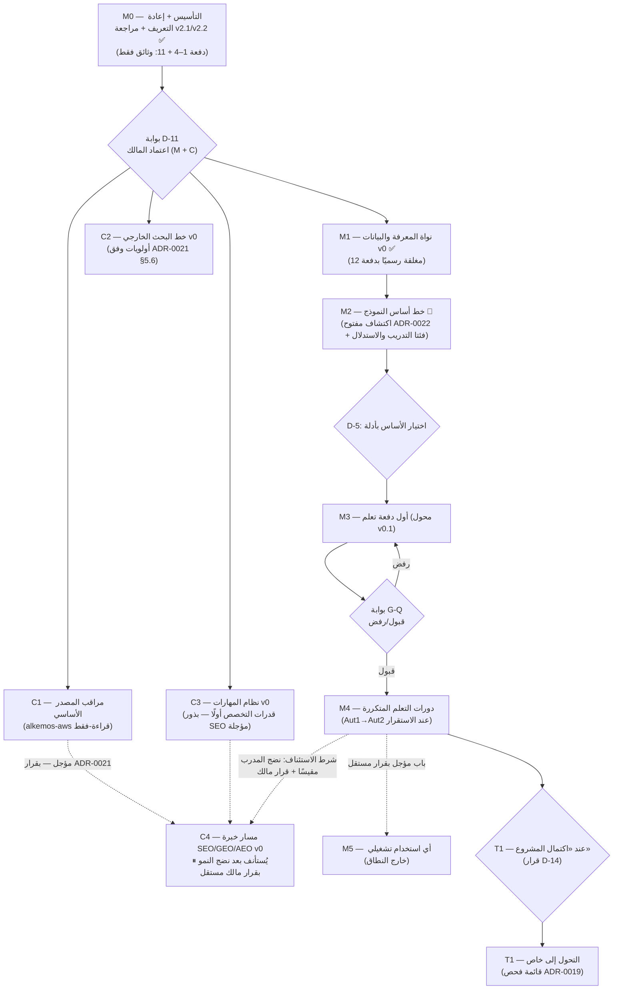

# MASTER_ROADMAP — خارطة الطريق (v2.5.0)

> إصدار: v2.5.0 · تاريخ: 2026-11-23 (UTC) (دفعة 14 — **بنية قياس M2: فحوص العدّاء v2 (المراجعة النوعية §7) + إعادة تصحيح النتائج الخمس + إطلاق قياس Jais-3-7B على GHA + عدّة Kaggle للفئة 20B+** · سابقًا دفعة 13-ب — استكمال M2 · دفعة 12 — الإغلاق الرسمي لـM1 + فتح M2 باكتشاف مرشحين مفتوح ADR-0022 · دفعة 11 — ADR-0021: تحويل الأولوية الاستراتيجية · دفعة 7 — تصحيح حالة بوابة D-11) · التفاصيل التنفيذية الكاملة في `PLAN.md` §10 — هذا الملف الخريطة والفهرس والبوابات فقط.
> **قاعدة البدء الملزمة:** لا تبدأ أي مرحلة تنفيذية (M1+ أو C1+) قبل اعتماد المالك — **D-11 صدر 2026-11-21 (UTC)** والتنفيذ بدأ بدفعة 6. **(دفعة 11):** توجيه الأولويات صار بـADR-0021 (2026-11-22 UTC): التخصص كمدرب أولًا، والمحتوى/SEO مؤجل (سجل التأجيل §4 أدناه).

## 1. خريطة التبعيات

## 2. جدول المراحل

| المرحلة | المخرج الرئيسي | معيار النجاح المركزي | الموارد | الحالة |
|---|---|---|---|---|
| **M0** — التأسيس + إعادة التعريف + مراجعة v2.1 | الخطة + ADR-0001..0019 + الحوكمة كاملة | وثائق متسقة مع التوجيهات الثلاثة، صفر تنفيذ | — | ✅ منجزة 2026-11-21 (UTC) |
| **M1** — نواة المعرفة والبيانات v0 | `datasets/v0.1` (أرقام مصححة) + `memory/` v2 (تعارضات/صناديق) + بطارية v0 + حسابات | G-M1: بطارية آلية موقعة + توثيق مصدر/ترخيص + أول دورة G-K تعمل | GHA CPU + عمل بشري | ✅ **منجزة ومغلقة رسميًا 2026-11-22 (UTC)** — دفعات 6+8+9+12 (تحقق الإغلاق في `docs/01-strategy/batch-12-m1-closure-report.md`) |
| **C1** — مراقب المصدر الأساسي | سير GHA مجدول + digests + صندوق مراجعة + `state.json` (UTC) | G-C1: أسبوعان تشغيل مستقر، digest لكل دفعة commits، بلا انقطاع غير مكتشف | GHA | 🔄 نشط 2026-11-21 (UTC) — دفعة 6 (كل 6 ساعات UTC؛ +D-15 للقراءة الدورية للقطات المحتوى) |
| **C2** — البحث الخارجي v0 | backlog + إجراءات جمع مصرحة + سجل مصادر/موثوقية | G-C2: ≥3 عمليات بحث كاملة التوثيق كلها «مرشحة» (صفر اعتماد تلقائي) | GHA + وصول عام | ⬜ — **أولويات البحث وفق درجات ADR-0021 §5.6** |
| **C3** — نظام المهارات v0 | هيكل `skills/` + مهارات معتمدة عبر G-S | G-C3: أول 5–10 مهارات معتمدة بحالات اختبار ناجحة آليًا | GHA CPU | ⬜ — **بذور seo-skills الثلاثين مؤجلة (ADR-0021)؛ الأولويات للقدرات الداعمة للتخصص** |
| **C4** — خبرة SEO/GEO/AEO v0 | (عند الاستئناف) بطاقات معرفة منهجية + أول تدقيق قراءة-فقط + خطة قياس | G-C4: تقرير تدقيق موثق بتوصيات — بلا أي تعديل إنتاجي (R-36) | GHA CPU + D-12 اختياريًا | **⏸ مؤجل بالكامل بقرار ADR-0021 (دفعة 11)** — أصوله محفوظة، والاستئناف بعد نضج النموذج بقرار مالك مستقل |
| **M2** — خط الأساس واختيار الأساس | قياس فئتي المرشحين (تدريب + استدلال مرجعي) على البطارية | G-M2/D-5: أساس مختار بأدلة على مهامنا الحقيقية | جلسة/جلستان Kaggle | 🔄 **نشطة 2026-11-22 (UTC) — دفعات 12+13-أ+13-ب+14** — تقرير الاكتشاف v1.1 + **5 قياسات عينة-36 منجزة** (4 GGUF على GHA + glm-4-plus عبر قناة الوكيل) + مراجعة نوعية + **(دفعة 14): فحوص العدّاء v2 منفذة (إصلاحات الفحص الستة — مثبتة 21/21) + النتائج الخمس أعيد تصحيحها بفحوص v2 (`rescore/` — فصل بروتوكول الإخراج عن المحتوى) + قياس Jais-3-7B مطلق على GHA + عدّة Kaggle جاهزة للفئة 20B+ فور التجديد** — المتبقي: نتائج Jais-3-7B ثم الفئة 20B+ على Kaggle ثم 162 الكاملة للمختصرين ثم توصية D-5 |
| **M3** — أول دفعة تعلم | محول LoRA v0.1 عبر دورة §4.2 كاملة + تسجيل ثلاثي | **عبور G-Q = بلوغ A2** | حصة Kaggle | ⬜ |
| **M4** — دورات التعلم المتكررة | إيقاع دوري + توحيد + DPO + مؤشرات `STATE.md` | G-M4: اتجاه دلتا موجب + توحيد يحفظ المكاسب (Aut1→Aut2) | Kaggle + GHA | ⬜ (مستمر) |
| **M5** — باب مؤجل | — (خارج النطاق بموجب ADR-0007) | يفتح فقط بقرار مالك مستقل | — | 🔒 مغلق |
| **T1** — التحول إلى خاص عند الاكتمال | تنفيذ قائمة فحص ADR-0019 عبر GitHub API | D-14 يحدد اللحظة؛ بعده المستودع خاص **والتعلم يستمر (بروتوكول ADR-0019 §6 — دفعة 5)** | — | 🔒 مؤجل بقرار D-14 |

> ترتيب تنفيذ مقترح بعد D-11 (محدّث بدفعة 11 وفق ADR-0021): M1 وC1 أولًا (الذاكرة والرصد أساس كل شيء) ثم C2/C3 بالتوازي بأولويات التخصص (§5.6)، وM2/M3/M4 في مسارها المستقل — **وC4 مؤجل بالكامل (§4 أدناه) لا يستهلك أي موارد حاليًا**.

## 3. نقاط الفحص الكبرى (Gates)

- **D-11 (قبل كل شيء):** اعتماد الخطة (مسارات M + C) — **✅ صدر 2026-11-21 (UTC)**؛ بدأ التنفيذ بدفعة 6.
- **ADR-0021 (دفعة 11 — توجيه الأولويات):** الهدف الأساسي مدرب لياقة شخصي ذكي احترافي عالمي · تسلسل المسار م ثابت · C4 وبذور seo-skills و`sft-blog-style-ar` وD-12 مؤجلة (سجل §4) · معايير القبول بالجودة والدقة والتفكير لا تُخفض.
- **D-15 (قبل التفعيل الدوري لقراءة لقطات المحتوى في C1):** تأكيد قائمة بيضاء جداول المحتوى (بلا PII) — يبقى نافذًا لجداول التغذية رغم تأجيل قراءة blog_posts.
- **G-C1/G-C2/G-C3 (نهايات مسارات C النشطة):** كما في الجدول. **G-C4 معلقة مع تأجيل المسار.**
- **G-M1: ✅ عبرت (دفعة 12 — 2026-11-22 UTC):** بطارية آلية موقعة (162 حالة) + بيانات موثقة الترخيص + أول دورة G-K (15 بطاقة) — التحقق الفعلي موثق في تقرير الإغلاق.
- **G-M2/D-5:** اختيار الأساس بأدلة على قائمة الاكتشاف المفتوح (ADR-0022 — لا قائمة مسبقة ولا حصر عائلات، وكل استبعاد موثق). **(دفعة 13-ب):** مصفوفة الأدلة جاهزة أولًا (اكتشاف + 5 قياسات عينة-36 + مراجعة نوعية). **(دفعة 14):** إصلاحات الفحص الستة (المراجعة النوعية §7) منفذة ومثبتة، والنتائج الخمس أعيد تصحيحها بفحوص v2 — المتبقي قبل التوصية: اكتمال قياس Jais-3-7B (مطلق على GHA) + الفئة 20B+ على Kaggle + المختصرون على 162 الكاملة.
- **G-Q (كل دفعة):** صفر انحدار >1% + تحسن مقيس — لا استثناءات.
- **G-M4 (كل 3 دفعات):** اتجاه الدلتا والاتحاد — عند الفشل: إيقاف وتشخيص موثق.
- **D-14 → T1 (ختامي):** لحظة الاكتمال → التحول إلى خاص بقائمة فحص ADR-0019.

## 4. سجل التأجيل (ADR-0021 — دفعة 11): الأعمال المؤجلة إلى ما بعد نضج النموذج

> تأجيل لا حذف — الأصول القائمة محفوظة ومجرودة وموثقة (التفصيل الكامل في `PLAN.md` §10-ج). **شرط الاستئناف الموحد:** تقدم مقيس موثق على أبعاد أداء المدرب (PLAN §7.2) + قرار مالك مستقل جديد.

| البند المؤجل | ملاحظة الحفظ |
|---|---|
| مسار C4 (خبرة SEO/GEO/AEO) كاملًا | تصميمه في ADR-0016/الخطة + جرد الكوربوس + CARD-0015 معتمدة تبقى |
| استيراد بذور seo-skills الثلاثين (C3) | المستودع fork قائم (MIT) + موثق في data-rights |
| `sft-blog-style-ar.jsonl` + أسلوب المقالات كقدرة | الأصل (151 مقالًا) مجرود وموثق الحقوق — لم يُنتج قط |
| قرار D-12 (تصدير GSC) | معلق في DECISIONS §3 — كان لقياس C4 |
| أي تدريب محتوى SEO/مقالات في الأوزان | لم يبدأ قط — ومجموعة البطارية للمجال تُبنى قبل أي تدريب كهذا |

## 5. خريطة الاستبدال والمصائر (كل التوجيهات)

| القديم | المصير |
|---|---|
| المرحلة 0 (التأسيس) + خط الأساس + فحص AWS + بحث المواقع المجانية | ✅ مرجع ساري |
| F0 → M1 · F1 → M1/M4 (أداة مساعدة) · F2 → M3 · F5 → عقد النقل §8 | كما في v2.0 |
| F3/F4 + المرحلة 8 (تشغيل/تكامل إنتاجي) | خارج النطاق — باب M5 فقط |
| **جرد Alkemos «لمرة واحدة» (v2.0)** | استُبدل بالمصدر الأساسي + المراقب (C1) |
| **سقف 4B/8B كقيد مشروع** | أُلغي (فئتان منفصلتان + تصعيد D-13 — ADR-0014) |
| **تواريخ الوثائق بتوقيت القاهرة** | قانون UTC (ADR-0013) — القديم يُقرأ قاهرةً |
| **«قياس مرجعي فقط» للنماذج الكبيرة** | فئة استدلال مستقلة قابلة للتشغيل بعد التكميم (M2 يقيس) |

## 6. مبادئ التنفيذ (نافذة عبر كل المراحل)

1. **موجة واحدة لكل دفعة:** مراجعة اتساق ← ADR عند الحاجة ← تحديث `STATE.md` ← commit/push إلى `main` (تواريخ UTC).
2. **الأدلة قبل الاعتماد:** لا نموذج ولا بيانات ولا مهارة تُعتمد دون قياس على مهامنا — والبوابات المعممة G-K/G-S/G-Q لا تُستثنى.
3. **التراكم لا يتوقف على مورد واحد:** اختفاء أي بيئة مجانية لا يوقف المعرفة/الذاكرة/المهارات (CPU) — يستأنف التدريب متى توفرت أي بيئة.
4. **صفر لمس الإنتاج:** لا مرحلة تكتب إلى أي نظام تابع لـAlkemos — الفحص والرصد قراءة فقط عبر GitHub API العام.
5. **الآلي يقترح وينفذ؛ الإنسان يعتمد:** (ADR-0018) — لا اعتماد تلقائي في أي مرحلة.
6. **الجودة قبل المجانية:** عند تعارض بوابة الجودة مع المسار المجاني → تصعيد D-13 — لا خفض معايير صامت.
7. **المالك يقرر:** كل نقطة إنفاق أو فتح باب تشغيلي أو تحويل المستودع إلى خاص = قرار موثق جديد.

