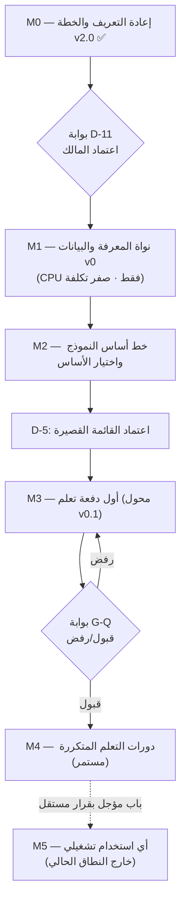

# MASTER_ROADMAP — خارطة الطريق (v2.0 بعد إعادة التعريف)

> إصدار: v2.0 · تاريخ: 2026-11-22 (دفعة 3 — ADR-0007) · التفاصيل التنفيذية الكاملة في `PLAN.md` §10 — هذا الملف الخريطة والفهرس والبوابات فقط.
> **قاعدة البدء الملزمة:** لا تبدأ أي مرحلة تنفيذية (M1+) قبل اعتماد المالك للخطة v2.0 (قرار D-11).

## 1. خريطة التبعيات

## 2. جدول المراحل

| المرحلة | المخرج الرئيسي | معيار النجاح المركزي | الموارد | الحالة |
|---|---|---|---|---|
| **M0** — إعادة التعريف والخطة v2.0 | `PLAN.md` + ADR-0007..0011 + تحديث الحوكمة + هيكل الطبقات | وثائق متسقة تمامًا مع التوجيه الجديد، صفر تنفيذ | — | ✅ منجزة 2026-11-22 |
| **M1** — نواة المعرفة والبيانات v0 | `datasets/v0.1` + `memory/` أولية + `alkemos-eval-v0` + حسابات HF/Kaggle | بطارية v0 تعمل آليًا على GHA بتقرير موقّع؛ كل ملف موثق المصدر والترخيص | GHA ‏CPU + عمل بشري | ⬜ بانتظار D-11 |
| **M2** — خط الأساس واختيار الأساس | قياس المرشحين على البطارية + قرار D-5 | أساس مختار بأدلة قياس على مهامنا الحقيقية (لا لوحات عامة) | جلسة/جلستان Kaggle | ⬜ |
| **M3** — أول دفعة تعلم | محول LoRA v0.1 عبر دورة §4.2 كاملة + تسجيل ثلاثي + تقرير | **عبور بوابة G-Q** = بلوغ درجة A2 في سلّم النمو | حصة Kaggle الأسبوعية | ⬜ |
| **M4** — دورات التعلم المتكررة | إيقاع شهري: بيانات ← دفعة ← بوابة ← تسجيل + توحيد دوري + DPO | مؤشرات `STATE.md`: دفعات مقبولة متتالية بلا انحدار + نمو حجم المعرفة + دلتا بطارية موجبة لكل دفعة | Kaggle + GHA | ⬜ (مستمر) |
| **M5** — باب مؤجل | — (خارج النطاق بموجب ADR-0007) | يفتح فقط بقرار مالك مستقل موثق | — | 🔒 مغلق |

## 3. نقاط الفحص الكبرى (Gates)

- **D-11 (قبل M1):** اعتماد خطة v2.0 — قرار مالك، بلا أي نفقة.
- **G-M1 (نهاية M1):** بطارية آلية موقعة + بيانات موثقة الترخيص → يفتح M2.
- **G-M2 / D-5:** اختيار الأساس بأدلة → يفتح M3.
- **G-Q (كل دفعة):** صفر انحدار >1% على المجموعة الحرجة + تحسن مقيس — القبول مشروط بها دائمًا (لا استثناءات).
- **G-M4 (مراجعة كل 3 دفعات):** اتجاه الدلتا إيجابي؟ التوحيد يحافظ على المكاسب؟ — عند فشل الاتجاه: إيقاف التوسع وتشخيص موثق قبل الدفعة التالية.

## 4. خريطة الاستبدال من الخطة القديمة (0–10 / F0–F5)

| القديم | المصير |
|---|---|
| المرحلة 0 (التأسيس) + خط الأساس + فحص AWS | ✅ باقٍ مرجعًا ساريًا |
| F0 (التأسيس المجاني) | مدموج في M1 |
| F1 (البيانات التركيبية) | مدموج في M1/M4 كأداة مساعدة منضبطة |
| F2 (أول QLoRA) | M3 |
| F3 (استضافة ذاتية للمهام الدفعية) | **خارج النطاق** — باب M5 فقط |
| F4 (توسيع الحصة الذاتية إنتاجيًا) | **خارج النطاق** — باب M5 فقط |
| F5 (قوانين النقل) | مدموج في عقد ADR-0009 |
| المرحلة 8 (وضع الظل والتكامل الإنتاجي) | **خارج النطاق** — باب M5 فقط |
| بحث المواقع المجانية (ZERO_COST_PLAN §2–§4) | ✅ مرجع ساري |
| وثائق المراحل القديمة `docs/00-10` | تبقى أرشيف بحثي مرجعي — لا تُحدَّث إلا بإحالة صريحة من الخطة الجديدة |

## 5. مبادئ التنفيذ (نافذة عبر كل المراحل)

1. **موجة واحدة لكل دفعة:** مراجعة اتساق ← ADR عند الحاجة ← تحديث `STATE.md` ← commit/push إلى `main`.
2. **الأدلة قبل الاعتماد:** لا نموذج ولا بيانات تُعتمد دون قياس على مهامنا (قانون «لا إدخال بلا دليل» الموروث).
3. **التراكم لا يتوقف على مورد واحد:** اختفاء أي بيئة مجانية لا يوقف المعرفة والذاكرة (CPU/بشري) — يستأنف التدريب متى توفرت أي بيئة.
4. **صفر لمس الإنتاج:** لا مرحلة تلمس Alkemos أو مزوديه أو خوادمه — قراءة فقط عند الحاجة.
5. **المالك يقرر:** كل نقطة إنفاق أو فتح باب تشغيلي = قرار موثق جديد.

