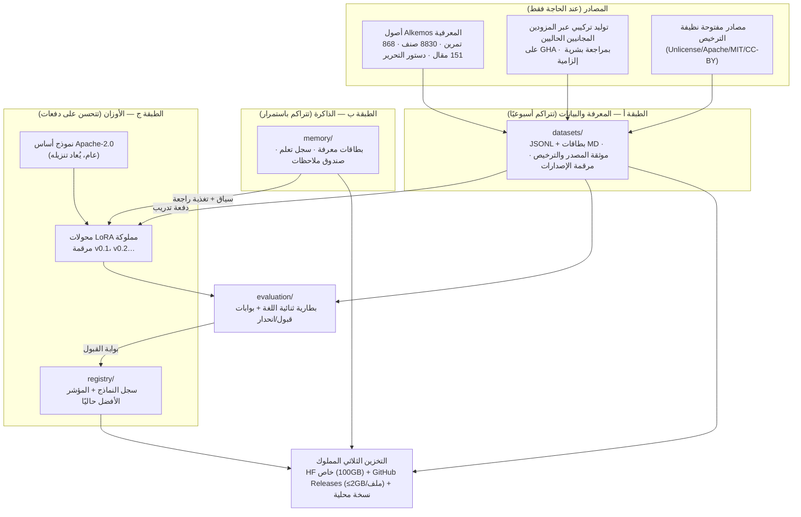

<div dir="rtl" align="right">

# PLAN — الخطة المعمارية والتنفيذية للمشروع المُعاد تعريفه (v2.0)

> **إصدار:** v2.0 · **تاريخ:** 2026-11-22 (دفعة 3) · **الحالة:** جاهزة لاعتماد المالك (قرار D-11)
> **المرجع المُلزم:** توجيه المالك 2026-11-22: «أعد تصميم مشروع AlkemosAI ليكون مشروعًا مستقلًا هدفه بناء نموذج ذكاء اصطناعي مملوك يتعلم ويتراكم ويتطور باستمرار، وليس تشغيله لخدمة المستخدمين أو استبدال نظام الذكاء الاصطناعي الحالي في Alkemos».
> **المنهجية:** نفس قوانين المشروع — كل رقم موسوم **[مُقيس]** (من كود/قياس/فحص حي) أو **[موثق]** (مصدر رسمي بتاريخ اطلاع) أو **[تقدير]** (حساب منطقي يحتاج قياسًا) أو **[غير متحقق]**. تم اليوم (2026-11-22): فحص حي قراءة-فقط لـ AWS + جرد أحدث نسخة احتياطية للمحتوى + تحقق ويب من المواقع المجانية والنماذج المفتوحة (المصادر في `references/sources-log.md` §6).
> **ما الذي تغيّر عن الخطة السابقة:** الخطة السابقة (المراحل 0–10 + مسار F0–F5) صُممت لهدف **تشغيلي**: خدمة مهام Alkemos تدريجيًا ووضع ظل وتكامل إنتاجي. هذه الخطة تستبدل ذلك بهدف **بنائي/بحثي**: نموذج مملوك يتعلم على دفعات ويتراكم. بحث المواقع المجانية في `ZERO_COST_PLAN.md` §2–§4 يبقى مرجعًا ساريًا؛ خطة التنفيذ F0–F5 مُستبدلة أدناه بالمراحل M1–M4 (انظر ADR-0007).

---

## 1. الملخص التنفيذي (لغير التقني)

AlkemosAI يصبح **مشروعًا مستقلًا لصناعة أصل معرفي**: نموذج ذكاء اصطناعي مملوك، متخصص في اللياقة والتغذية وعلوم الرياضة بالعربية والإنجليزية، **يتعلم على دفعات** — كل دفعة تضيف معرفة محفوظة وقابلًا مقيسًا ولا تُفقد ما سبق. النموذج لا يُشغَّل لخدمة أحد، ولا يستبدل نظام Alkemos الإنتاجي، ولا يحتاج خادمًا دائمًا أو GPU مستمرًا: كل شيء (معرفة، بيانات، ذاكرة، أوزان، سجلات تعلم) يعيش في **ملفات وأصول مملوكة قابلة للنقل** بين أي استضافة.

**ما نبدأ منه (مُقيس اليوم):** قاعدة معرفية فعلية جاهزة للتوظيف — 868 تمرينًا ثنائي اللغة، 8,830 صنف طعام، 7 برامج، 24 خطة غذائية، 151 مقالًا منشورًا، 230 سجل توليد، 169 مرجعًا غذائيًا، دستور تحرير كامل بـ14 جهة علمية موثوقة، وعشرات القوالب/البرومبتات الإنتاجية المجرّبة. هذه ليست افتراضات — إنها أصول Alkemos نفسها، تُستخدم هنا كمادة تعلم.

**ما يمكن إنجازه مجانًا فعلًا (موثق):** تدريب أسبوعي مجاني على Kaggle (30 ساعة GPU تتجدد أسبوعيًا)، حوسبة دفعية بلا حد على GitHub Actions، تخزين أوزان خاص مجاني (Hugging Face: ‏100GB للتخزين الخاص) + مرآة GitHub Releases (حتى 2GB للملف)، وأدوات مفتوحة بالكامل (Unsloth/PEFT/TRL/llama.cpp — Apache-2.0/MIT). تكلفة الخطة كلها: **صفر**، بلا بطاقة بنكية ولا اشتراك ولا تجارب مؤقتة.

**ما لا يمكن تجاوزه حاليًا (بصراحة):** لا تدريب نموذج من الصفر (يستحيل مجانًا)، لا GPU دائم مضمون (التعلم دفعات متقطعة بالتصميم)، لا «تعلم ذاتي حي» بلا تدخل بشري (البحث مفتوح عالميًا — نعوضه بذاكرة خارجية حية + دورات مقننة)، وحجم النموذج القابل للتدريب المجاني محدود عمليًا بـ ≤4B (و8B حدًا مضغوطًا). التفصيل في §9.

---

## 2. إعادة التعريف: الهدف والنطاق

### 2.1 الهدف الجديد (التعريف النهائي للنجاح)

> **نموذج لغوي مملوك متخصص (لياقة/تغذية/رياضة، عربي/إنجليزي) يتراكم تعلمه عبر دفعات مقننة: المعرفة والبيانات والذاكرة والأوزان وسجلات التعلم كلها أصول مملوكة في ملفات قابلة للنقل، وكل دفعة تعلم جديدة تعبر بوابة تقييم تمنع فقدان ما اكتُسب سابقًا.**

النجاح يُقاس بنمو النموذج (سلّم A0–A5 في `VISION.md`)، لا بأي مؤشر تشغيلي إنتاجي.

### 2.2 غير الأهداف (ملزمة — ADR-0007)

1. **لا تشغيل النموذج لخدمة مستخدمين** — لا واجهة عامة، لا محادثة حية، لا خدمة مهام لأي منتج.
2. **لا استبدال أو تعديل لنظام الذكاء الاصطناعي الحالي في Alkemos** — المزودون الخمسة + البحث اثنان لا يُمسون (خط الأساس §3).
3. **لا تكامل إنتاجي** — وضع الظل والمرحلة 8 القديمة خارج النطاق (باب مستقبلي فقط بقرار مالك مستقل).
4. **لا تشغيل دائم** — لا خادم استدلال مقيم، لا GPU مستمر، لا حاسوب مطلوب أن يبقى يعمل.
5. **لا واجهة تجميع APIs** — المشروع ليس مضيفًا لمزودين؛ المزودون الحاليون يُستخدمون **كأداة مساعدة عند الحاجة فقط** (توليد بيانات تركيبية)، والمسار الحرج (تدريب/تقييم/تخزين/نقل) لا يعتمد على أي مزود.
6. **لا التزام مالي** — لا اشتراك، لا بطاقة بنكية، لا تجارب تنتهي بمدفوعات، لا توسيع لاستهلاك AWS.

### 2.3 مصفوفة الامتثال لتوجيه المالك (2026-11-22)

| # | المطلوب في التوجيه | أين تحقق في هذه الخطة |
|---|---|---|
| 1 | نموذج خاص من نماذج مفتوحة بتراخيص تسمح بالتملك والتعديل | §7 + ADR-0011 (سياسة Apache-2.0/MIT فقط؛ القائمة القصيرة) |
| 2 | منظومة تعلم تراكمية: معرفة/ذاكرة/بيانات/تدريب/تحسين أوزان | §4 المعمارية (الطبقات الثلاث + دورة الدفعة) |
| 3 | توظيف المعرفة المتخصصة ومحتوى Alkemos الفعلي | §5 (جرد المُقيس: 868/8830/151/169…) |
| 4 | كل الأصول في ملفات مملوكة قابلة للنقل بين الاستضافات | §8 (عقد النقل والتخزين الثلاثي) |
| 5 | تعلم على دفعات، بلا تشغيل دائم ولا خادم استدلال ولا GPU مستمر | §4.2 + ADR-0010 (بيئات تدريب متقطعة) |
| 6 | حلول مجانية تمامًا + AWS القائمة دون تكاليف إضافية | §6 + §8 (صفر تكلفة؛ AWS تُحمَل ولا تُوسَّع — مُقيس $0) |
| 7 | مزودو Alkemos عند الحاجة، دون قفل لمزود واحد ودون واجهة تجميع | §5.3 (التوليد التركيبي: أداة مساعدة متنوعة المزودين بمراجعة بشرية) |
| 8 | لا اشتراط حاسوب دائم، ولا افتراض موارد غير مثبتة | §6 (كل مورد موثق بقياس/مصدر؛ لا افتراضات عتاد) |

**القيود الخمسة** (لا تشغيل للمستخدمين، لا مساس بإنتاج Alkemos، لا مدفوع، لا اعتماد على موارد مؤقتة كبنية دائمة، لا تنفيذ تدريب قبل اعتماد الخطة): نافذة كلها — هذه الدفعة وثائق فقط، وأول تنفيذ (M1) يبدأ بعد قرار D-11.

---

## 3. جرد الواقع — ما نملكه فعلًا (مُقيس 2026-11-22)

### 3.1 أصول المعرفة القابلة للتوظيف فورًا في التعلم

| الأصل | الحجم المُقيس | الموقع | ملاحظة الترخيص |
|---|---|---|---|
| مكتبة التمارين ثنائية اللغة | **868 تمرينًا** (أسماء/تعليمات/نصائح/عضلات/معدات) | `src/lib/exercises.ts` في مستودع الإنتاج | ملك Alkemos؛ الأصل المنبع `free-exercise-db` — **Unlicense (ملك عام)** [موثق] |
| قاعدة الأطعمة | **8,830 صنفًا** لكل 100غ (ماكروز + أسماء عربية) | `src/lib/foods.ts` (3.6MB) | ملك Alkemos + نطاقات USDA معرّبة |
| البرامج التدريبية | **7 برامج** كاملة | `src/lib/workout-programs.ts` | ملك Alkemos |
| مصفوفة الخطط الغذائية | **24 خطة** (6 مستويات سعرات × 4 أنظمة) | `src/lib/diet-plan-matrix.ts` | ملك Alkemos |
| مقالات المدونة المنشورة | **151 مقالًا** (2.2MB JSON) + **230 سجل توليد** (6.9MB) | جدولا `blog_posts`/`blog_generation_queue` — لقطة 2026-11-21 | ملك Alkemos (مولدة بمراجعة تحريرية) |
| الوصفات | 12 وصفة + 140 مكوّنًا + 22 نسخة | جداول `recipes*` | ملك Alkemos |
| المراجع الغذائية | **169 مرجعًا** | جدول `nutrient_reference` | ملك Alkemos |
| أنماط التعلم الغذائي الحتمي | 9 أنماط مجمعة | جدول `evo_nutrition_patterns` | ملك Alkemos (بلا PII) |
| **دستور التحرير** | بوابات جودة + **14 جهة علمية بيضاء** (WHO/NIH/CDC/Mayo/ACSM/ISSN…) | `blog-editorial-law.ts` | ملك Alkemos — أصل تدريبي فاخر للأسلوب والموثوقية |
| قوانين العربية (MSA) | كاشف اللاتيني + قواعد الفصحى المعاصرة | `blog-msa.ts`، `tool-msa.ts` | ملك Alkemos |
| البرومبتات الإنتاجية | EVO كامل + مولدا الخطط + أدوات `ai-job` العشرة + خط المدونة P0–P4 | `src/lib/*.ts` | ملك Alkemos — مواصفات مهام جاهزة للتقييم والتوليد |
| أدلة المنصة لـLLMs | `llms.txt` + `llms-full.txt` | مستودع الإنتاج | ملك Alkemos |
| أصول محرك السلطة | 6 مقالات أصلية EN + تصنيف نيش EN/AR | `alkemos-authority-engine/assets/` | ملك Alkemos |

**قاعدة صارمة (موروثة من SECURITY.md §3):** بيانات مستخدمي Alkemos (ملفات، قياسات، محادثات) **لا تدخل هذا المستودع ولا بيانات التدريب إطلاقًا** — مادة التعلم هي محتوى المنصة المعرفي فقط.

### 3.2 الموارد المجانية المثبتة (تحقق 2026-11-22 — التفصيل في `ZERO_COST_PLAN.md` §3 و`references/sources-log.md` §6)

| المورد | ما يقدمه | القيد الصادق |
|---|---|---|
| **GitHub Actions** (مستودع عام) | دقائق بلا حد على مشغلات قياسية (مهام ≤6 ساعات) | سجلات عامة؛ لا أسرار إلا في Secrets |
| **Kaggle** | **30 ساعة GPU/أسبوع** (T4×2 أو P100)، جلسات حتى ~12 ساعة، بلا بطاقة | يتجدد أسبوعيًا؛ لا SLA؛ ذاكرة جلسة مؤقتة |
| **Google Colab (مجاني)** | T4 عند التوفر | «وصول محدود جدًا» متغير — بديل احتياطي فقط |
| **Hugging Face Hub** | حساب مجاني بلا بطاقة + **100GB تخزين خاص** | «أفضل جهد»؛ ليس النسخة الوحيدة أبدًا (§8) |
| **GitHub Releases** | حتى **2GB للملف** كأصول إصدارات | يُستخدم مرآة ثانية للأوزان الكبيرة |
| **معالج محلي عند الحاجة** | تشغيل llama.cpp/Ollama (MIT) للنماذج الصغيرة والتقييم | لا يُفترض وجوده ولا ديمومته — أداة رفاهية (D-9) |
| **AWS القائمة** | لا شيء جديد: الإنتاج يعمل ($0 مُقيس سبتمبر–نوفمبر) داخل رصيد $100 حتى 2027-04-09 | **تُحمَل ولا تُوسَّع**؛ SCP يمنع GPU أصلًا؛ المثيل 1GB RAM لا يصلح للاستدلال [مُقيس] |
| **الأدوات المفتوحة** | Unsloth · PEFT · TRL · transformers (Apache-2.0) · llama.cpp · Ollama (MIT) · lm-evaluation-harness | تعمل على أي من المواقع أعلاه أو محليًا |

**مستبعدات بقرار المالك (ساريات):** Oracle Always Free وGCP/Azure (بطاقة) · R2 (يتطلب بطاقة حتى للمجاني — تحقق 2026-11-22) · Bedrock/RunPod/Vast (مدفوع) · Lightning/Modal (أرصدة تأسيسية/غير محسوم) · أي تجربة 12 شهرًا.

### 3.3 نماذج الأساس المرشحة (سياسة الترخيص ADR-0011: Apache-2.0/MIT فقط)

| المرشح | الحجم | الترخيص | الدور المقترح |
|---|---|---|---|
| **عائلة Qwen3.5 الصغيرة (0.8B/2B/4B)** | ≤4B | Apache-2.0 [موثق] | **هدف التدريب الأول** — عربية جيدة + قابل للتدريب المجاني بأريحية |
| gpt-oss-20b | 20B (MoE، 3.6B نشطة) | Apache-2.0 [موثق] | مرشح ثانٍ — كفاءة MoE؛ التدريب على T4 حدّي [تقدير] |
| OLMo 3 (7B/32B) | 7B+ | Apache-2.0 + بيانات وكود مفتوحة بالكامل [موثق] | خيار «الانفتاح الكامل» — بياناته موثقة المصدر بالكامل |
| Jais-30B | 30B | Apache-2.0 [موثق] | أقوى عربيًا محليًا — **أكبر من قدرة التدريب المجاني**؛ للقياس المرجعي فقط |
| Qwen3.5-35B-A3B | 35B (MoE) | Apache-2.0 [موثق] | مرجع جودة أعلى (قياس فقط) |

**مرفوضة:** Llama-4 (رخصة مجتمعية مشروطة) · Gemma-4 (ترخيص غير محسوم — تحفظ موثق سابقًا) · أي نموذج مغلق/API (يخالف هدف الملكية). الترتيب النهائي يحسمه القياس العملي في M2 (قرار D-5).

---

## 4. المعمارية — منظومة التعلم التراكمي

### 4.1 الطبقات الثلاث للتراكم

**المبدأ الحاكم:** التراكم لا يسكن الأوزان وحدها (لأن تحسين الأوزان مكلف ومتقطع)، بل يتوزع على ثلاث طبقات تتراكم كل منها بوتيرة مختلفة — وكلها ملفات مملوكة:



| الطبقة | ماذا تتراكم | وتيرة النمو | أين تعيش |
|---|---|---|---|
| **أ — المعرفة والبيانات** | أمثلة تدريب موثقة المصدر والترخيص، بطاقات معرفة خام | أسبوعيًا (دفعة صغيرة موثقة أفضل من كومة كبيرة) | `datasets/` في المستودع |
| **ب — الذاكرة** | الحقائق والتصحيحات وقواعد الأسلوب وقرارات التحرير + **سجل التعلم** (ماذا تعلمت كل دفعة وبأي نتيجة) | باستمرار (أرخص طبقة — لا تحتاج GPU) | `memory/` في المستودع |
| **ج — الأوزان** | الفارق المُتعلم: محولات LoRA + النماذج المدموجة | شهريًا تقريبًا (حسب حصة Kaggle وجودة البيانات) | `registry/` (البيانات الوصفية) + HF/Releases (الملفات) |

**لماذا هذا التصميم بالذات:** لو تعطلت كل بيئات التدريب المجانية غدًا، تظل الطبقتان أ وب تنموان بلا توقف (CPU/تحرير بشري)، ويُستأنف تحسين الأوزان متى توفرت أي بيئة تدريب — **التراكم لا يتوقف أبدًا على مورد واحد**.

### 4.2 دورة الدفعة (Batch Learning Cycle) — سبع خطوات مقننة

1. **جمع:** مادة جديدة إلى `memory/inbox/` — من أصول Alkemos، أو ملاحظات المالك/المدربين، أو مخرجات التوليد التركيبي (الموسومة `synthetic:` مع اسم المزود).
2. **تنقية:** مراجعة بشرية بالعينة + فحص ترخيص + إزالة تكرار → إصدار بيانات جديد (`datasets/vX.Y`) مع سجل تغيير ومصدر لكل ملف.
3. **تدريب:** جولة QLoRA على Kaggle (بنقاط حفظ قابلة للاستئناف — الجلسة قد تنقطع) بعناصر إعادة (replay) من إصدارات سابقة لمنع النسيان.
4. **تقييم:** البطارية ثنائية اللغة (§7) على المحول الجديد مقابل الأساس والإصدار السابق — على GHA أو ضمن جلسة Kaggle نفسها.
5. **بوابة القبول (G-Q):** يُقبل المحول فقط إذا: **صفر انحدار >1%** على المجموعة الحرجة (العربية/الأرقام/السلامة) + تحسن مقيس على مهام الدفعة. أي فشل = توثيق ورفض (لا استثناءات — القانون موروث من خط الأساس).
6. **تسجيل:** رفع المحول إلى HF الخاص + مرآة Releases + تحديث `registry/` + تقرير دفعة (بيانات الإصدار، النتائج، القرار) + تحديث سجل التعلم في `memory/`.
7. **توحيد (دوري كل عدة دفعات):** دمج المحولات المقبولة في محول موحّد يُدرَّب من مجموعة البيانات المتراكمة الكاملة، ويصبح هو «المؤشر الأفضل» — مع إبقاء التاريخ كاملًا في السجل.

**زمن الدورة الواقعية [تقدير]:** 1–4 أسابيع لكل دفعة كاملة، معظمها تنقية بشرية (عنق الزجاجة الحقيقي ليس GPU — بل جودة العربية المنقّحة). حصة Kaggle الأسبوعية تكفي 5–10 تجارب تدريب لنماذج ≤4B [تقدير موثق في ZERO_COST_PLAN §4.3].

### 4.3 ما الذي «يتعلم» فعلًا في كل دفعة (توزيع صادق)

| المكوّن | كيف يتعلم | تكلفة |
|---|---|---|
| المعرفة الواقعية (تمرين/صنف/مرجع) | تُحقن وقت الاستخدام من `datasets/`+`memory/` (استرجاع) — لا تحتاج تدريبًا | تقريبًا صفر |
| الأسلوب والهوية واللغة | تُدمَج في الأوزان عبر الدفعات (SFT ثم DPO لاحقًا) | GPU متقطع |
| التصحيحات والملاحظات | تُخزَّن في الذاكرة فورًا، وتُدمَج في الدفعة التالية | صفر |

هذا هو الجواب الهندسي الصادق لـ«يتعلم ويتراكم ويتطور باستمرار»: **التراكم مستمر في المعرفة والذاكرة (مجاني وفوري)، ومتدرج محكوم في الأوزان (دفعات مقننة)** — بدل ادعاء «تعلم ذاتي حي» لا يمكن ضمانه مجانًا (انظر §9).

---

## 5. المعرفة والبيانات (الطبقة أ — التفصيل)

### 5.1 خط الإنتاج من أصول Alkemos (مُقيس)

- **التمارين (868):** تحويل إلى أمثلة SFT ثنائية (سؤال عن الأداء/العضلة/المعدات ← إجابة من الحقول المنظمة) + بطاقات معرفة لكل تمرين. الأصل المنبع ملك عام (Unlicense) والتعريب والتوسعة ملك Alkemos — نظيف الترخيص بالكامل.
- **الأطعمة (8,830):** أزواج «استعلام غذائي ← ماكروز لكل 100غ» مع تنويع صياغات عربية/إنجليزية — **الأرقام تُحقن كحقول إلزامية** (قانون خط الأساس: لا توثق مجاميع النموذج أبدًا).
- **المقالات (151):** أهم أصل أسلوبي — تُحوَّل (عنوان/قسم/FAQ ← مقطع) مع وسم باب التحرير المقابل. **يُستثنى أي مقال يحمل اقتباسات طويلة من مصادر خارجية** حتى فحص ترخيصه (قائمة بيضاء §5.4).
- **البرامج/الخطط (7+24):** أمثلة «هدف/مستوى ← هيكل برنامج» و«سعرات/نظام ← خطة يوم» — بمنطق الدورات والتحميل الموجود في المنصة.
- **دستور التحرير وMSA والبرومبتات:** تتحول إلى (أ) بطاقات معرفة في الذاكرة، (ب) مواصفات مهام للبطارية، (ج) قوالب توليد تركيبي.

### 5.2 التوليد التركيبي (أداة مساعدة — لا عمود فقري)

- يُستخدم **عند الحاجة** لتوسيع الصياغات وتنويع الأمثلة عبر المزودين المجانيين الحاليين (الخمسة) داخل مهام GHA — نفس النمط الإنتاجي المجرّب (طابور كل 10 دقائق).
- **ضوابط إلزامية:** (1) تنويع المزودين — لا اعتماد على مزود واحد؛ (2) مراجعة بشرية بالعينة قبل أي دخول للبيانات؛ (3) وسم `synthetic:<provider>` لكل مثال مع تاريخه؛ (4) سقف نسبة التركيبي في كل إصدار بيانات [تقدير مبدئي: ≤50%] يُعاير بالقياس؛ (5) الأرقام الحسابية تُولَّد حتميًا خادميًا (موروث من بوابات خط الأساس) لا بالنموذج.
- **وضعه القانوني:** مخرجات المزودين عبر الطبقات المجانية تُعامل كأصول قابلة للاستخدام وفق شروطهم الحالية [غير متحقق قانونيًا بشكل نهائي — يُراجع قبل أي نشر تجاري للنموذج؛ للاستخدام الداخلي في التعلم لا مانع موثقًا].

### 5.3 هيكل `datasets/` المستهدف

```
datasets/
  v0.1/
    sft-exercises-ar.jsonl      # أزواج تعليمية — تمارين (عربي)
    sft-exercises-en.jsonl
    sft-foods-ar.jsonl          # استعلامات غذائية بأرقام إلزامية
    sft-blog-style-ar.jsonl     # أسلوب تحرير المدونة (من 151 مقالًا)
    sft-programs.jsonl
    LICENSE-LOG.md              # سجل ترخيص ومصدر كل ملف/سجل
    CHANGELOG.md
  eval/
    alkemos-eval-v0.jsonl       # بطارية التقييم (§7) — منفصلة عن التدريب دائمًا
```

قواعد: JSONL موقّع بـSHA256 لكل ملف · لا PII إطلاقًا · كل إصدار للبيانات يحمل رقمًا يربطه بدفعة التدريب وتقريرها.

---

## 6. الذاكرة (الطبقة ب — التفصيل)

- **بطاقات المعرفة:** ملف Markdown لكل مفهوم (تمرين/مكمل/مرض/حمية/قاعدة أسلوب) بصيغة موحدة: العنوان، التصنيف، الحقائق، المصدر، تاريخ آخر مراجعة، الحالة (مسودة/معتمدة).
- **سجل التعلم (`memory/learning-log.md`):** جدول حي: كل دفعة — رقمها، بياناتها، نتائجها، ما أُضيف، ما رُفض ولماذا. هذا هو «ضمير» التراكم: يجعل كل مكسب قابلًا للتفتيش وإعادة البناء.
- **صندوق الملاحظات (`memory/inbox/`):** يبدأ فارغًا؛ أي ملاحظة من المالك أو مراجع تُلقى هنا وتُفرز في التنقية التالية.
- **الفهرس قابل لإعادة البناء دائمًا (قانون موروث):** النص الأصلي مخزن في الملفات؛ أي فهرسة متجهة (pgvector/Vectorize/bge-m3 — الموثقة في ZERO_COST_PLAN §3.1) مجرد طبقة مشتقة تُعاد بناؤها بأمر واحد. تغيير نموذج التضمين = إعادة فهرسة، لا هجرة بيانات.

---

## 7. الأوزان والتقييم (الطبقة ج — التفصيل)

### 7.1 سياسة الأوزان

- الأساس عام Apache-2.0 يُعاد تنزيله عند الحاجة؛ **الأصل المملوك هو المحول (LoRA) وسجل النماذج والبيانات والذاكرة** — وترخيص Apache-2.0 يضمن ملكية التعديلات وحق استخدامها تجاريًا مستقبلًا [موثق من نص الرخصة].
- سقف الحجم التدريبي المجاني الحالي: **≤4B بأريحية، 8B حدًا مضغوطًا على T4 16GB** [تقدير من متطلبات QLoRA] — لذلك Jais-30B والمرشحات الكبيرة للقياس المرجعي فقط.
- أدوات التدريب: Unsloth/PEFT/TRL (Apache-2.0) على Kaggle — بنقاط حفظ كل N خطوة واستئناف تلقائي.
- التقدم: SFT أولًا (M3) ثم DPO بأزواج تفضيل من مراجعات المالك (M4) [تقدير].

### 7.2 بطارية التقييم (بوابة كل شيء)

- **alkemos-eval:** 100–200 حالة v0 تُبنى في M1 من مهام المنصة الحقيقية: أدوات `ai-job` العشرة، أسئلة EVO النمطية، قيود الخطط (تطابق مكتبة التمارين ±20% سعرات)، وقواعد دستور التحرير (استشهاد من القائمة البيضاء فقط، لا لاتيني في العربية…).
- تُشغَّل آليًا: على GHA (نماذج ≤2B مكمّمة GGUF عبر llama.cpp) أو داخل جلسة Kaggle نفسها (للأكبر).
- **قانون البوابة (G-Q):** قبول المحول = لا انحدار >1% على المجموعة الحرجة + تحسن مقيس على مهام الدفعة + نتائج موقعة تُحفظ في `evaluation/results/` مع كل تقرير.
- البطارية **لا تدخل بيانات التدريب أبدًا** (فصل صارم)، وتنمو مع كل مجال جديد قبل تدريبه (قانون موروث من المرحلة 7 القديمة).

---

## 8. الملكية والتخزين والنقل (عقد ملزم)

### 8.1 التخزين الثلاثي للأوزان الكبيرة

| النسخة | الموقع | الدور | الحد |
|---|---|---|---|
| 1 (أساسية) | **HF Hub — مستودع خاص** | التخزين الدائم الأول للمحولات/GGUF | 100GB خاصة [موثق] |
| 2 (مرآة) | **GitHub Releases** (وسم `model-vX.Y`) | استقلال عن HF — سحب مباشر بأداة git | 2GB/ملف [موثق] |
| 3 (محلية) | أي جهاز متاح عند التحمين | نسخة الطوارئ/العمل بلا إنترنت | حسب العتاد المتاح |

المستودع (GitHub) يحمل دائمًا: الكود، البيانات، الذاكرة، السجل، والبيانات الوصفية + روابط الأصول. **لا توجد أي أصل في موقع واحد أبدًا.**

### 8.2 عقد إعادة البناء من الصفر (قابلية النقل المثبتة)

إعادة إنتاج النظام كاملًا على أي استضافة تتطلب فقط:
1. استنساخ هذا المستودع (كود + بيانات + ذاكرة + سجل).
2. تنزيل الأوزان من أي نسخة متاحة (HF أو Releases أو محلية) — روابطها وSHA256 في `registry/`.
3. تنزيل النموذج الأساس العام (Apache-2.0) من مصدره العلني.
4. تشغيل سكربت البطارية للتحقق (نتائج مطابقة للسجل = النقل سليم).

**قوانين النقل (موروثة ومحدثة من ZERO_COST_PLAN §8):** مُخرَج واحد يعمل في أي مكان · لا ميزة موقع-خاصة في المسار الحرج · الذاكرة قابلة لإعادة الفهرسة دائمًا · لكل مورد مجاني بديل ذاتي معلن · لا اعتماد تشغيلي على مورد يتطلب بطاقة.

---

## 9. ما لا يمكن إنجازه مجانًا حاليًا (الحدود الصادقة)

| # | القيد | لماذا (الواقع المُقيس/الموثق) | ماذا نفعل بدلًا منه |
|---|---|---|---|
| 1 | **تدريب نموذج من الصفر (pretraining)** | يحتاج مئات ساعات GPU بمقادير غير متاحة مجانًا — بنيويًا خارج المتناول | نبني فوق أساس مفتوح (وهو جوهر «المملوك»: الفارق المُتعلم + حق الترخيص) |
| 2 | **GPU دائم/مضمون** | Kaggle 30س/أسبوع بلا SLA؛ Colab متقلب؛ AWS محجوبة SCP وبلا GPU مجاني | التعلم دفعات متقطعة بالتصميم + نقاط حفظ قابلة للاستئناف + بديلان لكل بيئة |
| 3 | **«تعلم ذاتي حي» بلا تدخل بشري** | مسألة بحث مفتوحة عالميًا (catastrophic forgetting/التقييم الذاتي) وليست قابلة للضمان مجانًا | تراكم مستمر في المعرفة/الذاكرة + دفعات أوزان مقننة ببوابات (§4.3) |
| 4 | **تدريب نماذج >8B** | T4 16GB سقف QLoRA العملي [تقدير يُقاس في M2] | المرشحات الكبيرة (Jais-30B…) للقياس المرجعي فقط حتى يتغير الواقع |
| 5 | **خدمة استدلال مضمونة** | تحتاج عتادًا دائمًا — وهو أصلًا **خارج هدف المشروع الحالي** | تشغيل محلي عند الحاجة (llama.cpp/Ollama) للفحص والتقييم فقط |
| 6 | **جودة العربية للصغار غير مثبتة** | [غير متحقق — القياس هو M2] | بوابة تقييم تحسم؛ عند فشل ≤4B يُوثق ويعاد الترتيب (بدائل بترخيص نظيف) |
| 7 | **تخزين خاص غير محدود** | GitHub يرفض ملفات >100MB؛ HF الخاص 100GB «أفضل جهد» | الثلاثية (§8.1) + ضغط + GGUF مكمّم |
| 8 | **سعة مراجعة بشرية** | عنق الزجاجة الحقيقي: تنقية العربية | دفعات صغيرة عالية الجودة بدل كمّ منخفض الجودة |

---

## 10. خطة التنفيذ — المراحل M0–M5

> كل مرحلة تُغلق ببروتوكول المشروع: مراجعة ← ADR عند الحاجة ← تحديث `STATE.md` ← commit/push. **لا مرحلة تنفيذية تبدأ قبل قرار D-11.** لا مرحلة تلمس إنتاج Alkemos.

### M0 — إعادة التعريف والخطة ✅ (هذه الدفعة، 2026-11-22)
المخرجات: هذه الوثيقة + ADR-0007..0011 + تحديث الحوكمة (README/VISION/ROADMAP/STATE/DECISIONS/RISK/COSTS/SECURITY/sources) + هيكل المستودع المستهدف (مجلدات الطبقات). **لا كود تنفيذي ولا تدريب.**

### M1 — نواة المعرفة والبيانات v0 (2–4 أسابيع · CPU فقط · صفر تكلفة)
- بناء `datasets/v0.1`: التمارين + الأطعمة + البرامج + أسلوب المدونة (من الأصول المُقيسة §3.1) مع سجل تراخيص كامل.
- بناء `memory/`: أول 100–200 بطاقة معرفة + سجل التعلم + الصندوق.
- بناء `evaluation/alkemos-eval-v0` (100–200 حالة من المهام الحقيقية) وتشغيلها آليًا على GHA كخط أساس فارغ.
- إنشاء الحسابات المجانية المطلوبة (HF/Kaggle — بلا بطاقة).
- **معيار النجاح (G-M1):** بطارية v0 تعمل آليًا وتخرج تقريرًا موقعة؛ كل ملف بيانات له مصدر وترخيص موثقان.

### M2 — خط أساس النموذج واختيار الأساس (1–2 أسبوع · GPU خفيف)
- قياس المرشحين (Qwen3.5 0.8B/2B/4B؛ ومرجعيًا gpt-oss-20b وJais-30b للقياس فقط) على البطارية — على Kaggle/GHA.
- **بوابة (G-M2):** اختيار الأساس بقرار موثق (D-5) — «لا إدخال بلا دليل قياس».

### M3 — أول دفعة تعلم (v0.1) (2–4 أسابيع · ضمن حصة Kaggle)
- جولة QLoRA كاملة وفق دورة §4.2: بيانات v0.1 → محول → بطارية → بوابة G-Q → تسجيل ثلاثي + سجل.
- **بوابة (G-M3):** أول محول مقبول = بلوغ درجة A2 في سلّم النمو.

### M4 — دورات التعلم المتكررة (مستمر · إيقاع شهري تقريبًا)
- التوليد التركيبي المنضبط (§5.2) لتوسيع البيانات + DPO بأزواج تفضيل من مراجعات المالك.
- التوحيد الدوري (دمج المحولات المقبولة) وتحديث «المؤشر الأفضل».
- مؤشرات المتابعة في `STATE.md`: عدد الدفعات المقبولة/المرفوضة، حجم المعرفة، دلتا البطارية لكل دفعة، نسبة التركيبية.

### M5 — (باب مؤجل بقرار مستقل) أي استخدام تشغيلي
خارج النطاق بموجب ADR-0007. أي فتح لهذا الباب (خدمة، تكامل مع Alkemos، استضافة دائمة) يتطلب قرار مالك جديدًا موثقًا + مراجعة COST_MODEL — **لا يُقترح ولا يُلحق تلقائيًا بأي مرحلة أعلاه.**

### خريطة الاستبدال من الخطة القديمة

| القديم (0–10 / F0–F5) | المصير |
|---|---|
| المرحلة 0 (التأسيس) + خط الأساس + فحص AWS | ✅ باقٍ ومرجع ساري |
| المسار الصفري F0 (تأسيس مجاني) | مدموج في M1 |
| F1 (بيانات تركيبية) | مدموج في M1/M4 كأداة مساعدة (§5.2) |
| F2 (أول QLoRA) | M3 |
| **F3 (استضافة ذاتية للمهام الدفعية)** | **خارج النطاق (ADR-0007)** — يفتح فقط ضمن باب M5 |
| **F4 (توسيع الحصة الذاتية إنتاجيًا)** | **خارج النطاق (ADR-0007)** |
| F5 (قوانين النقل) | مدموج في §8 (عقد النقل) |
| المرحلة 8 (وضع الظل والتكامل) | خارج النطاق — باب M5 |
| بحث المواقع المجانية (ZERO_COST_PLAN §2–§4) | مرجع ساري |

---

## 11. المخاطر الجديدة (تُضاف إلى `RISK_REGISTER.md`)

R-22 انزلاق النطاق نحو التشغيل · R-23 تراخيص بيانات خارجية · R-24 تخفيف التراكم (دفعات تضيف ضجيجًا لا قدرة) · R-25 تحيز التوليد التركيبي لمزود واحد · R-26 فقدان الأوزان عند تغير شروط موقع تخزين. التفصيل والتخفيف في السجل.

## 12. القرار المطلوب الآن من المالك

- **D-11 (الأولوية القصوى):** اعتماد خطة v2.0 هذه وبدء M1 — **بلا أي نفقة** (CPU + حسابات مجانية فقط).
- تظل مفتوحة بترتيب أدنى: D-5 (اعتماد القائمة القصيرة للنماذج — يحسمها قياس M2) · D-9 (عتاد المالك — رفاهية تشغيل محلي أسرع، ليست شرطًا) · D-3 (منظمة AWS — باب مستقبلي فقط).

---

> **قانون هذا الملف:** أي تعديل جوهري بعد الاعتماد = ADR جديد يحيل إليه. الفحوص اللاحقة تضاف بأقسام مؤرخة — الأصل لا يُعدل.

</div>
