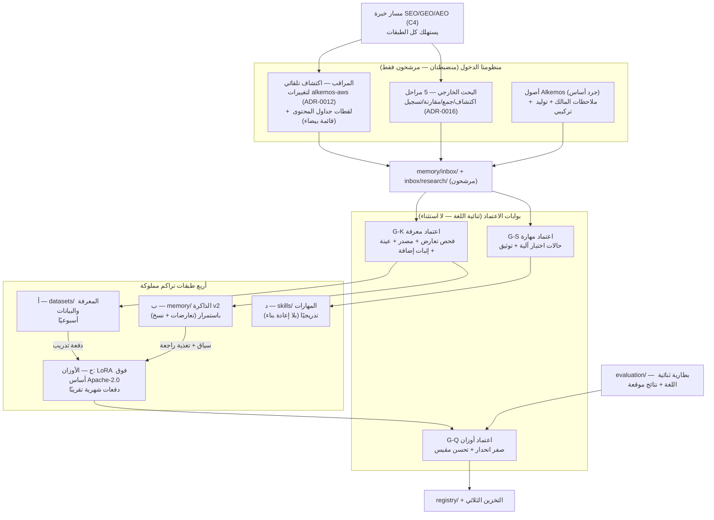

<div dir="rtl" align="right">

# PLAN — الخطة المعمارية والتنفيذية (v2.1)

> **إصدار:** v2.1.3 · **تاريخ:** 2026-11-22 (UTC) · **دفعة:** 10 — تحديث الموارد بتفعيل الحسابات (ADR-0020: HF ‏`Alkemos` + مستودع أوزان خاص + Kaggle ‏`AlkemosAI` — الأسرار في GitHub Secrets والتحقق المقيس مُنجز — جاهزية M2 بلا تدريب) · سابقتها: دفعة 7 — تصحيح حالة اعتماد D-11 (صدر وبدأ التنفيذ بدفعة 6)
> **الحالة:** **معتمدة بقرار المالك D-11 (صدر 2026-11-21 UTC):** أمر المالك «ابدأ بالتنفيذ للمشروع حسب الخطة» — التنفيذ بدأ بدفعة 6 (M1 + C1 نشطان؛ C2–C4 لاحقًا بالترتيب المقترح)
> **المرجع المُلزم (توجيه المالك، دفعة 4):** «أعد تقييم وتحديث خطة مشروع AlkemosAI بالكامل وفق التوضيحات الجديدة، دون بدء التدريب أو التشغيل أو إجراء أي تغييرات على نظام Alkemos الحالي» + تسع نقاط (المصدر الأساسي · SEO/GEO/AEO · اكتساب المهارات · البحث الخارجي · النموذج والموارد · الذاكرة والتطور · الاستقلالية · الملكية والاستضافة · التوقيت UTC).
> **المنهجية (ثابتة):** كل رقم موسوم **[مُقيس]** (كود/قياس/فحص حي) أو **[موثق]** (مصدر رسمي بتاريخ اطلاع) أو **[تقدير]** (حساب منطقي يحتاج قياسًا) أو **[غير متحقق]**. تنفيذًا لها: فحص حي قراءة-فقط اليوم للمستودع الأساسي `alkemos-aws` @ `ed57082` عبر GitHub API (شجرة كاملة + عدّ مباشر للملفات المعرفية) + موقع alkemos.com + مستودعات الحساب الشقيقة (الأدلة في `references/sources-log.md` §7).
> **قانون التوقيت:** UTC مرجعًا وحيدًا للطوابع المخزنة (ADR-0013) — تواريخ هذه الوثيقة وأعلاها UTC.

## 0. ما الذي تغيّر في v2.1 (ولماذا)

| # | التغيير | الأصل |
|---|---|---|
| 1 | **alkemos-aws يعيَّن مصدرًا أساسيًا** + مراقب اكتشاف تلقائي لكل إضافة/تعديل مستقبلي يغذي دورة المراجعة والتعلم | توجيه المالك 1 → ADR-0012 |
| 2 | **SEO/GEO/AEO مجال خبرة تراكمي من الدرجة الأولى** بتعلم تحليل/تدقيق/اكتشاف مشكلات/استراتيجية/قياس/تطوير | توجيه المالك 2 → §4 و§10 (C4) |
| 3 | **الطبقة د — المهارات** (`skills/`): إضافة تدريجية موثقة مقيمة الجودة بلا إعادة بناء + بوابة G-S | توجيه المالك 3 → ADR-0015 |
| 4 | **خط بحث خارجي** بخمس مراحل مع **فصل صارم بين الجمع والاعتماد** | توجيه المالك 4 → ADR-0016 |
| 5 | **إلغاء سقف 4B/8B** كقيد مشروع؛ فصل الاستدلال عن التدريب؛ قانون «الجودة قبل المجانية» بتصعيد D-13 | توجيه المالك 5 → ADR-0014 |
| 6 | **ذاكرة v2:** كشف تعارضات + نسخ قديمة + تعميم بوابات الاعتماد ثنائية اللغة (G-K/G-S/G-Q) | توجيه المالك 6 → ADR-0017 |
| 7 | **سلّم الاستقلالية Aut0–Aut3**: نمو الآلي في الاقتراح/التنفيذ لا في الاعتماد | توجيه المالك 7 → ADR-0018 |
| 8 | **الملكية والنقل** مفصلة (حقوق الأساس مقابل ملكيتنا) + **العلنية مؤقتة والتحول إلى خاص عند الاكتمال** | توجيه المالك 8 → ADR-0019 |
| 9 | **قانون UTC الموحد** للمستودعات (نافذ فورًا — يفسر التاريخ القديم بتوقيت القاهرة) | توجيه المالك 9 → ADR-0013 |
| 10 | **تصحيح أرقام:** الأطعمة **8,162** (لا 8,830) — عدّ مباشر من `src/lib/foods.ts` @ ed57082 (تصحيح رقم PLAN v2.0 §3.1 الذي وُرد بلا دليل مباشر)؛ التمارين **868** مؤكدة | فحص حي 2026-11-21 → §3.1 |

---

## 1. الملخص التنفيذي (لغير التقني)

AlkemosAI مشروع مستقل لصناعة **أصل معرفي مملوك يتعلم ويتراكم**: نموذج ذكاء اصطناعي متخصص (لياقة/تغذية/علوم رياضة، عربي/إنجليزي) يتعلم على دفعات مقننة، **محاطًا بأربع طبقات تراكم مملوكة** (معرفة وبيانات · ذاكرة · مهارات · أوزان) و**منظومتي دخول منضبطتين**: مراقب المصدر الأساسي (alkemos-aws) وخط بحث خارجي — كل دخول معرفة يمر ببوابة ثنائية اللغة تثبت الإضافة قبل الاعتماد (لا اعتماد غير موثق ولا افتراض تعلم ذاتي).

**المسار المزدوج الجديد:** إلى جانب مسار النموذج (M1–M4)، يبني المشروع **خبرة SEO/GEO/AEO متراكمة** (تحليل وتدقيق واستراتيجية وقياس) من أصول Alkemos الفعلية الموثقة (دستور تحرير، ذروة انهيار فهرسة −76% قيد التحقيق، ملفات مخططات SEO/GEO في المصدر الأساسي، مهارات seo-skills الثلاثون) — **توصيات ووثائق فقط، بلا أي تعديل على الإنتاج**.

**ما يبدأ الآن بلا أي التزام مالي (موثق):** كل شيء في المراحل M1 + C1–C4 يعمل على GHA المجانية للمستودع العام (مراقبة، بحث، تقييم، مهارات) وCPU فقط، بلا بطاقة ولا اشتراك. التدريب عند بلوغه (M3) يعمل ضمن حصة Kaggle المجانية. **لا يُشترى شيء ولا يُستأجر شيء في هذه الخطة.**

**ما الذي لا نضحي به:** جودة النموذج. إن عجز المسار المجاني عن بلوغ بوابة الجودة، فذلك **تصعيد موثق للمالك** (D-13) بخيارات مقيسة الأسعار — القرار قراره، ولا خفض للمعايير صامت (ADR-0014).

---

## 2. الهدف والنطاق

### 2.1 الهدف (تعريف النجاح — v2.1)

> **نظام معرفي مملوك يتعلم ويتراكم:** نموذج لغوي متخصص (عربي/إنجليزي) تتراكم معرفته وذاكرته ومهاراته وأوزانه في أصول مملوكة قابلة للنقل، يستمد معرفته أساسًا من مستودع Alkemos الأساسي (بآلية اكتشاف تلقائية لكل تغيير)، ويبني بحثًا خارجيًا وخبرة SEO/GEO/AEO متراكمة، ويقبل كل تعلم جديدًا فقط عبر بوابة تقييم ثنائية اللغة تمنع فقدان المكتسب — بلا تشغيل لخدمة مستخدمين وبلا مساس بإنتاج Alkemos.

النجاح يُقاس بنمو النموذج (سلّم A0–A5 في `VISION.md`) + نمو أصول المعرفة/الذاكرة/المهارات (سجل التعلم)، لا بأي مؤشر تشغيلي.

### 2.2 غير الأهداف (ملزمة — ADR-0007، مؤكدة بدفعة 4)

1. لا تشغيل النموذج لخدمة مستخدمين (باب M5 مغلق بقرار مستقل).
2. لا استبدال أو تعديل لنظام الذكاء الاصطناعي الحالي في Alkemos — المزودون الخمسة + بحثان لا يُمسون.
3. لا تكامل إنتاجي ولا وضع ظل.
4. لا تشغيل دائم (لا خادم استدلال مقيم ولا GPU مستمر).
5. لا واجهة تجميع APIs — المزودون الحاليون أداة مساعدة عند الحاجة فقط (توليد تركيبي متنوع المزودين).
6. لا التزام مالي — لا اشتراك ولا بطاقة ولا تجارب تنتهي بمدفوعات.
7. **(جديد)** لا تعديل على إنتاج Alkemos ولو «لتحسين SEO» — مخرجات مسار الخبرة توصيات ووثائق فقط (R-36).
8. **(جديد)** لا افتراض تعلم ذاتي تلقائي ولا اعتماد معلومات غير موثقة — كل اعتماد ببوابة مقيسة (ADR-0016/0017/0018).

### 2.3 مصفوفة الامتثال لتوجيه المالك (دفعة 4 — النقاط التسع)

| # | المطلوب | أين تحقق |
|---|---|---|
| 1 | المصدر الأساسي + اكتشاف تلقائي يغذي دورة المراجعة والتعلم | §5.2 + ADR-0012 + المرحلة C1 |
| 2 | خبرة SEO/GEO/AEO متراكمة متخصصة (تحليل/تدقيق/اكتشاف/استراتيجية/قياس/تطوير) | §4 (نطاق الخبرة) + المرحلة C4 + ADR-0015 (مهارات SEO) |
| 3 | اكتساب مهارات تدريجي موثق مقيم الجودة بلا إعادة بناء | §4 (الطبقة د) + ADR-0015 + المرحلة C3 |
| 4 | بحث خارجي مستقل قابل للتطوير + فصل الجمع عن الاعتماد | §5.4 + ADR-0016 + المرحلة C2 |
| 5 | لا سقف 4B/8B؛ فصل الاستدلال عن التدريب؛ لا تضحية بالجودة؛ أفضل مسار بلا التزام مالي | §3.3 + §7.1 + §9 + ADR-0014 |
| 6 | فصل المعرفة/الذاكرة/المهارات عن الأوزان + تعارضات ونسخ قديمة + تقييم ثنائي يثبت التحسن قبل كل اعتماد | §4/§6 + ADR-0017 |
| 7 | قابلية توسع نحو بحث/تعلم/مهارات/أداء بلا افتراض تعلم تلقائي | §4.4 (سلّم Aut) + ADR-0018 |
| 8 | نقل البيانات/الذاكرة/المهارات/الأوزان + حقوق الأساس مقابل ملكيتنا + خاص عند الاكتمال | §8 + ADR-0019 + T1/D-14 |
| 9 | قانون UTC موحد + توثيق المحلي عند الحاجة | ADR-0013 (نافذ) + رؤوس الوثائق |

**قيود هذه الدفعة (4) تحديدًا:** وثائق وخطة فقط — لا تدريب بدأ، ولا نموذج شُغل، ولا ربط بنظام Alkemos، ولا تعديل على الإنتاج أو مزوديه، ولا إنشاء أي التزام/خدمة مدفوعة. القرارات التي تحتاج موافقة المالك معلقة في §12.

---

## 3. جرد الواقع — ما نملكه فعلًا (فحص حي 2026-11-21 UTC)

### 3.1 أصول المعرفة من المصدر الأساسي (alkemos-aws @ `ed57082`)

| الأصل | الحجم المُقيس | الدليل | ملاحظة الترخيص |
|---|---|---|---|
| مكتبة التمارين ثنائية اللغة | **868 تمرينًا** (عدّ slug/imageKey) | `src/lib/exercises.ts` | الأصل المنبع free-exercise-db — **Unlicense (ملك عام)** [موثق] + إثراءات ملك Alkemos (16 دفعة enrichment) |
| قاعدة الأطعمة | **8,162 صنفًا** لكل 100غ (عدّ slug/nameAr/nameEn/per100g — مطابق تعليق الملف نفسه) — **تصحيح: الرقم 8,830 الوارد في v2.0 كان بلا دليل مباشر** | `src/lib/foods.ts` (~3.3MB) | ملك Alkemos + نطاقات USDA معرّبة [موثق] |
| البرامج التدريبية | **7 برامج** | `src/lib/workout-programs.ts` | ملك Alkemos |
| الخطط الغذائية | **24 خطة** (6 مستويات × 4 أنظمة) | `src/lib/diet-plan-matrix.ts` | ملك Alkemos |
| مقالات المدونة المنشورة | **151 مقالًا** (2.2MB) + 230 سجل توليد | جدولا `blog_posts`/`blog_generation_queue` — لقطة 2026-11-21 (جداول محتوى فقط، بلا PII) | ملك Alkemos |
| الوصفات | 12 وصفة + 140 مكوّنًا | جداول `recipes*` | ملك Alkemos |
| المراجع الغذائية | **169 مرجعًا** | جدول `nutrient_reference` | ملك Alkemos |
| دستور التحرير + قوانين MSA | بوابات جودة + **14 جهة علمية بيضاء** | `blog-editorial-law.ts`، `blog-msa.ts`، `tool-msa.ts` | ملك Alkemos — أصل تعلم موثوقية |
| البرومبتات الإنتاجية | EVO كامل + مولدا الخطط + أدوات `ai-job` العشرة + خط المدونة | `src/lib/*.ts` | ملك Alkemos |
| أدلة المنصة لـLLMs | `llms.txt` + `llms-full.txt` | المستودع الأساسي | ملك Alkemos — أصل AEO قائم فعلًا |

**قاعدة صارمة (SECURITY §3):** بيانات مستخدمي Alkemos لا تدخل هذا المستودع ولا بيانات التدريب إطلاقًا — مادة التعلم هي محتوى المنصة المعرفي فقط.

**(دفعة 5) حقوق كل أصل موثقة تفصيلًا في [`references/data-rights.md`](references/data-rights.md)** (المنبع/الترخيص/أساس الحق/الفارق المملوك) — لا يوصف أي أصل بأنه «ملك حصري» إلا بأساس موثق هناك؛ المنابع الخارجية (free-exercise-db/USDA/مهارات MIT) تبقى بتراخيصها.

### 3.2 أصول النظام البيئي الموثقة (مستودعات الحساب — قراءة-فقط)

| الأصل | ما يوفره للتعلم | الحالة |
|---|---|---|
| **alkemos-aws** (عام، نشط) | المصدر الأساسي: 8,362 مدخلًا/7,070 ملفًا؛ **130 ميجريشن**؛ **56 workflow**؛ **199 ملف docs/** | [مُقيس 2026-11-21] |
| **كوربوس SEO/GEO/AEO داخل المصدر الأساسي** | `SEO-GEO-MASTER-PLAN` · `CONTENT-QUALITY-SEO-GEO-AUDIT` · `SEO-EEAT-FRAMEWORK` · `SEO-SCHEMA-REFERENCE` · `GSC-*` (فحوص Search Console) · `blog-keyword-relevance.ts` · `seo.ts` · `sitemap-xml.ts` · `evo-geo-answer.ts` (وحدة إجابات GEO فعلية) | [مُقيس — جرد الشجرة] |
| **alkemos-authority-engine** (خاص) | منهجية اكتساب سلطة white-hat كاملة: 7 قنوات، تصنيف روابط صادق، 171 اختبارًا، تشغيل مرتين يوميًا UTC | [موثق من README، اطلاع 2026-11-21] |
| **seo-skills** (عام، fork لـIllyism/seo-skills) | **30 مهارة SEO جاهزة (SKILL.md، MIT)** — بذور الطبقة د (مرشحة، تُكيف وتُقيَّم فرديًا) | [مُقيس] |
| **musclehubeg-backups** (خاص) | لقطات يومية JSON لقاعدة Supabase — **قراءة جداول المحتوى فقط** (قائمة بيضاء → D-15) | [موثق] |
| **Agent-Reach** (عام، fork، MIT) | أداة تمكين وكلاء من قراءة الإنترنت — **مرشح أدوات بحث يُقيَّم** | [غير متحقق التقييم] |
| **alkemos** (خاص) | سلف غير نشط (آخر دفع 2026-10-10) — يُتجاهل؛ المرجع الأساسي alkemos-aws | [مُقيس] |
| **free-exercise-db** (عام) | منبع مكتبة التمارين — Unlicense | [موثق] |

**قضية تعلم حقيقية موثقة (لمسار C4):** انهيار فهرسة Alkemos الجاري تحقيقه (من القمة 1,462 إلى 351 صفحة مؤرشفة [موثق في خط الأساس §7.3]) + إقرار authority-engine بأن «الأساس التقني مكتمل والسلطة الخارجية شبه معدومة» — مادة حالة واقعية كاملة لخبرة SEO/GEO/AEO تُبنى من التدقيق لا من الكتب.

### 3.3 نماذج الأساس المرشحة (سياسة ADR-0014: بلا سقف — فئتان مستقلتان)

**فئة أ — أساس التدريب الأولي (ضمن حصة التدريب المجانية الحالية، يُحسم قياسًا في M2):**

| المرشح | الحجم | الترخيص | الدور |
|---|---|---|---|
| عائلة Qwen3.5 الصغيرة (0.8B/2B/4B) | ≤4B | Apache-2.0 [موثق من ملف الرخصة] | **هدف التدريب الأولي** — عربية جيدة + قابل للتدريب المجاني بأريحية |
| gpt-oss-20b | 20B (MoE، ~3.6B نشطة) | Apache-2.0 [موثق] | مرشح ثانٍ — تدريبه على T4 حدّي [تقدير] |

**فئة ب — الاستدلال والقياس المرجعي (بلا سقف حجم؛ يُشغَّل الملائم بعد التكميم GGUF على CPU عند توفر RAM، أو ضمن جلسات تقييم):**

| المرشح | الحجم | الترخيص | الدور |
|---|---|---|---|
| Qwen3.5-35B-A3B | 35B (MoE) | Apache-2.0 [موثق] | مرجع جودة أعلى + مرشح استدلال مستقبلي |
| gpt-oss-120b | 120B (MoE، ~5.1B نشطة) | Apache-2.0 [موثق] | مرجع عميق (يحتاج 80GB GPU أو إلغاء تحميل CPU [موثق]) |
| Jais-30B | 30B | Apache-2.0 [موثق] | أقوى عربي محلي — مرجع عربي أول |
| OLMo 3 (7B/32B) | 7B/32B | Apache-2.0 + بيانات/كود مفتوحة كاملة [موثق] | خيار الانفتاح الكامل — بيانات موثقة المصدر بالكامل |

**قوانين الفئتين (ADR-0014):** (1) لا سقف مشروع — حدود اليوم وصف لبيئات التدريب المجانية يُقاس في M2 لا قرار معماري؛ (2) ترقية الأساس لاحقًا رخيصة المعرفة (الطبقات مستقلة عن الأوزان)؛ (3) الجودة أولًا — التعارض مع المجانية يُصعَّد للمالك (D-13) ولا يُحل بخفض المعيار؛ (4) المرشح الجديد يمر بسياسة الترخيص ADR-0011 (فحص ملف LICENSE من مصدره). **مرفوضة:** Llama-4 (رخصة مجتمعية مشروطة) · Gemma-4 (غير محسوم) · أي نموذج مغلق عبر API.

### 3.4 الموارد المجانية المثبتة (كما في v2.0 — مرجع ساري `ZERO_COST_PLAN.md` §3)

GHA بلا حد **للمستودع العام فقط** (بعد التحويل إلى خاص T1: 2,000 دقيقة/شهر بالخطة المجانية — ADR-0019 §6) · Kaggle 30 GPU-س/أسبوع (حصة أسبوعية قابلة للتغيير من مزودها بلا SLA) · Colab احتياطًا · HF ‏100GB تخزين خاص · GitHub Releases ≤2GB/ملف · وصول مباشر مجاني لواجهات عامة (PubMed/arXiv/Wikipedia/الجهات البيضاء) بلا مفاتيح [موثق] · Tavily طبقة مجانية 1,000 رصيد/شهر لحساب جديد [غير متحقق — يُثبت عند التنفيذ] · أدوات Apache-2.0/MIT (Unsloth/PEFT/TRL/llama.cpp/lm-eval). **قانون الحصص (دفعة 5): كل حصة مجانية قابلة للتغيير من مزودها وليست ضمانًا — المصادر الرسمية بتواريخ اطلاعها في `references/sources-log.md` §8.** **AWS القائمة تُحمَل ولا تُوسَّع** ($0 مُقيس، SCP يمنع GPU، المثيل 1GB لا يصلح للاستدلال [مُقيس]). المستبعدات بقرار مالك سارية (Oracle/GCP/Azure/R2 — بطاقة؛ RunPod/Vast/Bedrock — مدفوع؛ Lightning/Modal — تجارب/غير محسوم).

> **تحديث دفعة 10 (ADR-0020 — 2026-11-22 UTC):** الحسابان مفعّلان ومتحقق منهما مقيسًا (لا موثقًا فقط): HF ‏`Alkemos` بتوكن fine-grained (repo.write ✓) + مستودع أوزان **خاص فعليًا** `Alkemos/alkemosai-weights` (ساق الثلاثية 1 — ADR-0009) · Kaggle ‏`AlkemosAI` بمفتاح KGAT نشط (scope: `resources.admin:*`) — الحصة قُرئت حية: GPU ‏30 س/أسبوع (0 مستخدمة) + TPU ‏20 س/أسبوع، تجدد `2026-11-28T00:00:00Z`، وخدمة kernels تقبل Bearer فقط (ترفض Basic). الاعتماديات في GitHub Secrets (`HF_TOKEN`·`KAGGLE_USERNAME`·`KAGGLE_KEY`) والتحقق المرجعي داخل Actions نجح (run ‏45028375241). **القيد النافذ ما زال: لا تدريب قبل استكمال M1 وحسم D-5.** التفصيل: `docs/03-infrastructure/hf-kaggle-integration.md` + `references/sources-log.md` §9.

---

## 4. المعمارية — منظومة التعلم التراكمي الموسعة (v2.1)

### 4.1 أربع طبقات تراكم + منظومتا دخول منضبطتان

**المبدأ الحاكم:** التراكم يتوزع على **أربع طبقات** مملوكة بوتائر مختلفة، وكلها تُغذَّى من **مصدرين دخول منضبطين** (المراقب والبحث) عبر **بوابات اعتماد ثنائية اللغة** — فلا دخول بلا دليل، ولا اعتماد تلقائي:



| الطبقة | ماذا تتراكم | الوتيرة | أين تعيش |
|---|---|---|---|
| **أ — المعرفة والبيانات** | أمثلة تدريب موثقة المصدر/الترخيص، بطاقات معرفة خام | أسبوعيًا | `datasets/` |
| **ب — الذاكرة** | بطاقات معرفة معتمدة + سجل تعلم + تعارضات ونُسخ | باستمرار (بلا GPU) | `memory/` |
| **ج — الأوزان** | محولات LoRA مملوكة + النماذج المدموجة | دفعات (~شهريًا) | `registry/` + HF/Releases |
| **د — المهارات (جديدة)** | بطاقات SKILL.md موثقة مقيمة الجودة ببيانات اختبارها | تدريجيًا (بلا إعادة بناء) | `skills/` |

**لماذا هذا التصميم:** لو تعطلت كل بيئات التدريب غدًا تظل الطبقات أ/ب/د تنمو بلا توقف (CPU/بشري)، ويُستأنف تحسين الأوزان متى توفرت أي بيئة — والترقية إلى أساس أكبر/أفضل (ADR-0014) مسألة إعادة ضبط لا إعادة بناء.

### 4.2 دورة التعلم (تسع خطوات — تشمل الاكتشاف والاعتماد)

1. **رصد واكتشاف:** المراقب يلتقط تغييرات المصدر الأساسي (digests بروابط وSHA وطوابع UTC)؛ البحث الخارجي ينتج مرشحين موثقي المصدر؛ الملاحظات والتوليد التركيبي يدخلان الصناديق.
2. **فرز وتنقية:** مراجعة عينة بشرية + فحص ترخيص + إزالة تكرار + **كشف تعارضات مع الذاكرة القائمة** (ADR-0017).
3. **بوابة G-K:** اعتماد معرفة/بيانات = مصدر موثق + لا تعارض غير محلول + إثبات إضافة مقيسة (بطاقات/أزواج جديدة) + صياغة عربية/إنجليزية سليمة + توقيع بتاريخ UTC.
4. **بناء الدفعة:** إصدار بيانات `vX.Y` بسجل تغيير ومصدر لكل ملف + بطاقات معرفة معتمدة.
5. **تدريب:** جولة QLoRA على Kaggle بنقاط حفظ قابلة للاستئناف + عناصر إعادة (replay) من إصدارات سابقة.
6. **تقييم:** البطارية ثنائية اللغة على المحول الجديد مقابل الأساس والإصدار السابق (وتنمو البطارية قبل تدريب أي مجال جديد).
7. **بوابة G-Q:** قبول المحول فقط إذا: **صفر انحدار >1%** على المجموعة الحرجة (العربية/الأرقام/السلامة) + تحسن مقيس على مهام الدفعة. أي فشل = توثيق ورفض.
8. **تسجيل:** رفع المحول إلى HF الخاص + مرآة Releases + تحديث `registry/` + تقرير دفعة + تحديث سجل التعلم.
9. **توحيد دوري:** دمج المحولات المقبولة في محول موحد يُدرَّب من البيانات المتراكمة الكاملة ويصبح «المؤشر الأفضل» — التاريخ كامل في السجل.

**زمن الدورة [تقدير]:** 1–4 أسابيع لكل دفعة كاملة؛ عنق الزجاجة التنقية البشرية لا GPU.

### 4.3 ما الذي «يتعلم» فعلًا (توزيع صادق)

| المكوّن | كيف يتعلم | تكلفة |
|---|---|---|
| المعرفة الواقعية (تمرين/صنف/مرجع/نتيجة بحث موثقة) | تُحقن وقت الاستخدام من `datasets/`+`memory/` — بلا تدريب | ~صفر |
| الأسلوب والهوية واللغة | تُدمَج في الأوزان عبر الدفعات (SFT ثم DPO لاحقًا) | GPU متقطع |
| المهارات (مجالات/أدوات/أساليب جديدة) | بطاقات `skills/` موثقة مقيمة — تُقرأها الوكلاء وتُنفذ بلا إعادة بناء | صفر (CPU) |
| التصحيحات والملاحظات | تُخزَّن في الذاكرة فورًا وتُدمَج في الدفعة التالية | صفر |

### 4.4 نطاق خبرة SEO/GEO/AEO (مسار C4 — تعريف المفاهيم عند أول استخدام)

**SEO** تهيئة الظهور في محركات البحث؛ **GEO** تهيئة الظهور في محركات الذكاء الاصطناعي التوليدي (ChatGPT وأمثالها)؛ **AEO** تهيئة الظهور في محركات الإجابات والمقتطفات المميزة.

مسار الخبرة يتعلم الدورة الكاملة — **تحليل وتدقيق ← اكتشاف مشكلات ← استراتيجية ← قياس ← تطوير مستمر** — من مادة حقيقية: كوربوس المصدر الأساسي (مخططات SEO-GEO، تدقيقات GSC، قانون الكلمات المفتاحية، evo-geo-answer.ts)، حالة الانهيار الموثقة (−76% فهرسة)، منهجية authority-engine، ومهارات seo-skills. **مخرجاته دائمًا وثائق وتوصيات داخل هذا المستودع** — أي تنفيذ على موقع Alkemos قرار مالك مستقل (R-36). القياس بلا تصدير GSC يستعمل إشارات عامة موسومة [تقدير] — ويُطلب التصدير القراءة-فقط بقرار D-12.

### 4.5 سلّم الاستقلالية (ADR-0018) — القيد الحاكم

Aut0 (حالي: كل دورة بقيادة المالك/الوكيل) ← Aut1 (اكتشاف آلي: مراقب + بحث مجدولان ينتجان مرشحين؛ الاعتماد بشري) ← Aut2 (تجهيز آلي للدفعات؛ القرار بشري) ← Aut3 (تنفيذ دورات معتمدة النمط بإيقاف فوري عند أي انحراف؛ بقرار مالك مستقل). **قانون ثابت: الآلي ينمو في الاقتراح والتنفيذ، لا في الاعتماد — ولا مستوى يسمح اعتمادًا غير موثق أو خدمة مستخدمين.**

---

## 5. المعرفة والبيانات (الطبقة أ — التفصيل)

### 5.1 خط الإنتاج من أصول المصدر الأساسي (كما في v2.0 — بالأرقام المصححة)

- **التمارين (868):** أمثلة SFT ثنائية (سؤال ← إجابة من الحقول المنظمة) + بطاقة معرفة لكل تمرين — نظيف الترخيص بالكامل (منبع Unlicense + إثراءات ملك Alkemos).
- **الأطعمة (8,162):** أزواج «استعلام غذائي ← ماكروز لكل 100غ» بتنويع صياغات عربية/إنجليزية — **الأرقام حقول إلزامية** (لا توثق مجاميع النموذج أبدًا).
- **المقالات (151):** أصل أسلوبي — استثناء أي مقال باقتباسات طويلة حتى فحص ترخيصه.
- **البرامج/الخطط (7+24) + دستور التحرير وMSA والبرومبتات:** أمثلة مهام + بطاقات + مواصفات البطارية + قوالب توليد تركيبي.
- **(جديد) كوربوس SEO/GEO/AEO:** يُحوَّل إلى بطاقات معرفة منهجية (إطار EEAT، مراجع السكيما، أنماط اكتشاف الكلمات) + مادة مسار C4.

### 5.2 المصدر الأساسي والمراقب (ADR-0012 — القلب الجديد)

1. **alkemos-aws هو المصدر الأساسي الأول** — كل استشهاد يحيل إلى SHA وتاريخ اطلاع (UTC).
2. **المراقب:** سير GHA مجدول (تقدير البدء: كل 6 ساعات UTC) قراءة-فقط عبر GitHub API العام: مقارنة HEAD بآخر SHA مُشاهد (`research/source-watch/state.json`) → **digest لكل دفعة commits** (SHA، الطابع UTC، الملفات، وسوم معرفي/غير معرفي) → المسارات المعرفية فقط تدخل `memory/inbox/`.
3. **مسارات معرفية (تدخل المراجعة):** `src/lib/**` المعرفية · `docs/**/*.md` · `supabase/migrations/**` · ملفات الحوكمة العليا (STATE/AGENTS/worklog).
4. **لقطات المحتوى اليومية (musclehubeg-backups):** جداول المحتوى فقط بقائمة بيضاء (blog_posts، nutrient_reference، recipes*، evo_nutrition_patterns) — **تأكيد المالك D-15 قبل التفعيل الدوري**؛ جداول المستخدمين/PII محظورة مطلقًا.
5. **قراءة فقط دائمًا** — لا كتابة إلى أي نظام تابع لـAlkemos.

### 5.3 التوليد التركيبي (أداة مساعدة — كما في v2.0)

عند الحاجة، عبر المزودين المجانيين الحاليين في مهام GHA بضوابطه الخمسة (تنويع المزودين · مراجعة عينة · وسم `synthetic:<provider>` بتاريخ UTC · سقف نسبة [تقدير مبدئي ≤50%] يُعاير · الأرقام حتميًا خادميًا).

### 5.4 البحث الخارجي (ADR-0016 — خط مستقل)

اكتشاف (backlog) ← جمع (مصادر مصرحة: واجهات عامة رسمية بلا مفاتيح؛ Tavily لحساب جديد [غير متحقق]؛ Agent-Reach مرشحًا) ← مقارنة وتصديق (مصدران مستقلان + قائمة موثوقية بيضاء: الجهات الـ14 + .gov/.int/.edu + محكم الأقران) ← تسجيل (`research/external/runs/`: روابط + تواريخ اطلاع UTC + اقتباس/هاش + درجة) ← **مرشحون فقط** → G-K. لا دخول مباشر للمعرفة أبدًا.

### 5.5 هيكل `datasets/` المستهدف (كما في v2.0 + وسم المصدر الأساسي)

```
datasets/
  v0.1/
    sft-exercises-ar.jsonl / sft-exercises-en.jsonl
    sft-foods-ar.jsonl          # 8,162 صنفًا — أرقام إلزامية
    sft-blog-style-ar.jsonl     # أسلوب 151 مقالًا
    sft-programs.jsonl
    LICENSE-LOG.md              # سجل ترخيص ومصدر كل ملف/سجل (incl. alkemos-aws @ SHA)
    CHANGELOG.md
  eval/                         # البطارية — منفصلة عن التدريب دائمًا
```

---

## 6. الذاكرة (الطبقة ب — v2، ADR-0017)

### 6.1 بنية `memory/`

```
memory/
  cards/            # بطاقات معرفة v2 (إصدار + آخر مراجعة UTC + حالة + superseded-by + contradicts + أصل كامل)
  learning-log.md   # سجل التعلم: كل اعتماد (معرفة/مهارة/أوزان) بقياس قبل/بعد
  inbox/            # صناديق المراجعة: ملاحظات المالك + digests المراقب + مرشحو البحث
  conflicts/        # قائمة القرار للتعارضات غير المحسومة
  archive/          # البطاقات المشطوبة (مؤرشفة بتاريخ وسبب — لا حذف)
```

### 6.2 القواعد

1. **كشف التعارض إلزامي عند كل اعتماد** (كيان/حقل): قيمة جديدة تخالف قائمة → علامة + قائمة قرار — **لا كتابة صامتة فوق معرفة قائمة**؛ الحسم بالموثوقية والتوثيق والأحدث؛ الخاسر يُشطب بسبب موثق ويُؤرشف.
2. **بوابة G-K:** مصدر موثق + لا تعارض غير محلول + إثبات إضافة مقيسة + فحص ثنائي اللغة (AR/EN) + توقيع بتاريخ UTC.
3. **سجل التعلم «ضمير التراكم»:** يغطي المعرفة والمهارات والأوزان معًا.
4. **الفهرس مشتق دائمًا** — أي فهرسة متجهة (pgvector/Vectorize/bge-m3) طبقة تُعاد بناؤها بأمر واحد.

---

## 7. الأوزان والتقييم (الطبقة ج — سياسة ADR-0014)

### 7.1 سياسة الأوزان (مُعاد صياغتها)

1. **بلا سقف مشروع:** حدود بيئات التدريب المجانية الحالية (T4 16GB QLoRA — تدريب ≤4B بأريحية و8B حدًا مضغوطًا [تقدير يُقاس في M2]) وصف مرحلي لا قرار معماري؛ تدريب الأكبر = بند موارد مستقبلية خلف D-13.
2. **فئة الاستدلال مستقلة:** المراجع الكبيرة/MoE تُقاس على البطارية وتُشغَّل بعد التكميم (GGUF/CPU) عند توفر RAM كافٍ [تقدير — يُقاس M2؛ يعتمد على D-9] — جودة المرجع لا تُشترط مجانيتها لأن تشغيله المرجعي رخيص/مؤقت.
3. **الجودة أولًا:** بوابة G-Q مطلقة — عند فشل المسار المجاني: توثيق + تصعيد D-13 بخيارات COST_MODEL §2 — لا خفض معايير.
4. **الترقية رخيصة المعرفة:** تغيير الأساس مستقبلًا = إعادة ضبط المحولات فوق الأساس الجديد بالبيانات المتراكمة (الطبقات مستقلة عن الأوزان) — مراجعة دورية للقائمة القصيرة مع كل مراجعة خطة كبرى.
5. **الملكية (ADR-0011 ساري):** الأساس العام Apache-2.0 يُعاد تنزيله؛ الأصل المملوك هو المحول والبيانات والذاكرة والمهارات والسجل. أدوات المسار الحرج Apache-2.0/MIT فقط. التقدم: SFT (M3) ثم DPO (M4).

### 7.2 بطارية التقييم (بوابة كل شيء — مُوسَّعة)

- **alkemos-eval v0 (M1):** 100–200 حالة من مهام المنصة الحقيقية (أدوات ai-job العشرة، أسئلة EVO، قيود الخطط، قواعد الدستور).
- **(جديد) بطارية المهارات:** كل مهارة تجلب حالات اختبارها الخاصة (G-S) — تعمل على GHA/CPU.
- **(جديد) بطارية مجال SEO/GEO/AEO:** قبل تدريب أي محتوى SEO (قانون نمو البطارية قبل التدريب).
- **قانون البوابة G-Q:** قبول = صفر انحدار >1% على المجموعة الحرجة + تحسن مقيس + نتائج موقعة في `evaluation/results/` بتواريخ UTC. البطارية لا تدخل بيانات التدريب أبدًا.

---

## 8. الملكية والتخزين والنقل (عقد ملزم — ADR-0019 + ADR-0009)

### 8.1 تصنيف الملكية (حقوق الأساس مقابل ملكيتنا)

| الأصل | الملكية/الحقوق |
|---|---|
| نموذج الأساس (Apache-2.0/MIT) | مفتوح من مزوده: تعديل + توزيع + استخدام تجاري مع حفظ إشعاراته؛ وسماته وأسماؤه التجارية ملك أصحابها |
| بياناتنا وذاكرتنا ومهاراتنا ومحولاتنا وسجلات تعلمنا | الملكية حصرية في **الفارق المُتعلم** (الإثراءات والبنية والمحولات والسجلات)؛ المنابع الخارجية تخضع لتراخيصها وموثقة في `references/data-rights.md` (دفعة 5) — لا ادعاء ملكية على ما ليس من صنعنا؛ ترخيص النشر الخارجي يقرر عند التحول (D-14) |

### 8.2 التخزين الثلاثي للأوزان (ساري)

| النسخة | الموقع | الحد |
|---|---|---|
| 1 (أساسية) | HF Hub — مستودع خاص | 100GB [موثق] |
| 2 (مرآة) | GitHub Releases (وسم `model-vX.Y`) | ≤2GB/ملف [موثق] |
| 3 (محلية) | أي جهاز عند التحمين | حسب العتاد |

المستودع يحمل دائمًا: الكود والبيانات والذاكرة **والمهارات** والسجلات والبيانات الوصفية. **لا أصل مملوك في موقع واحد أبدًا.**

### 8.3 عقد إعادة البناء (يغطي الطبقات الأربع)

استنساخ المستودع + تنزيل الأوزان بأي نسخة متاحة (روابط وSHA256 في `registry/`) + تنزيل الأساس العام + تشغيل البطارية للتحقق = النظام كامل في أي مكان. قوانين النقل (موروثة): مخرج واحد يعمل في أي مكان · لا ميزة موقع-خاصة · الذاكرة قابلة لإعادة الفهرسة · لكل مورد مجاني بديل ذاتي معلن · لا اعتماد تشغيلي على مورد يتطلب بطاقة.

### 8.4 العلنية المؤقتة والتحول إلى خاص (ADR-0019)

المستودع **عام مؤقتًا للمراجعة فقط** (أسبابه التشغيلية: دقائق GHA — ADR-0006). **يتحول إلى خاص عند اكتمال المشروع** عبر بروتوكول T1 بقرار D-14: مسح أسرار نهائي ← تدوير مفاتيح المحادثات (R-32) ← قبول بقاء الـforks العامة عامة (سلوك GitHub الموثق) — **ومنه القاعدة: لا يوضع في العلني ما لا يصح بقاؤه عامًا أبدًا** ← أرشفة إن لزم ← تنفيذ عبر API وتوثيقه. أثر مفهوم (دفعة 5): انخفاض دقائق GHA إلى 2,000 دقيقة/شهر بعده — **والتعلم يستمر بعده وفق بروتوكول ADR-0019 §6** (طبقات أ/ب/د على CPU ضمن الرصيد بإيقاع مضبوط + تدريب الأوزان على Kaggle مستقل عن GitHub + التخزين الثلاثي لا يتأثر؛ وما يتجاوز المجاني باب D-13).

---

## 9. ما لا يمكن إنجازه مجانًا حاليًا (الحدود الصادقة — v2.1)

| # | القيد | الواقع | ماذا نفعل |
|---|---|---|---|
| 1 | تدريب من الصفر (pretraining) | مئات ساعات GPU غير متاحة مجانًا — بنيوي | نبني فوق أساس مفتوح (جوهر «المملوك») |
| 2 | GPU دائم/مضمون | Kaggle بلا SLA · Colab متقلب · AWS محجوبة SCP | دفعات متقطعة قابلة للاستئناف + بديلان لكل بيئة |
| 3 | «تعلم ذاتي حي» بلا تدخل بشري | مسألة بحث مفتوحة — غير قابلة للضمان | تراكم مستمر في الطبقات + بوابات اعتماد + سلّم استقلالية لا يصل للاعتماد الذاتي (ADR-0018) |
| 4 | **تدريب >8B ضمن المجاني الحالي** | T4 16GB حد QLoRA العملي [تقدير يُقاس M2] — **ليس سقفًا للمشروع**: بند موارد مستقبلية خلف D-13، والترقية لأساس أكبر لاحقًا رخيصة المعرفة (الطبقات مستقلة) | تصعيد موثق بقرار مالك عند حاجة الجودة — لا رفض نهائي ولا خفض معيار |
| 5 | خدمة استدلال مضمونة | عتاد دائم — خارج الهدف أصلًا | تشغيل محلي عند الحاجة للفحص/التقييم فقط |
| 6 | جودة العربية للصغار غير مثبتة | [غير متحقق — M2 يحسم] | بوابة تقييم + توثيق فشل وإعادة ترتيب إن لزم (بترخيص نظيف) |
| 7 | تخزين خاص غير محدود | GitHub >100MB يرفض؛ HF «أفضل جهد» | الثلاثية + ضغط + GGUF |
| 8 | سعة مراجعة بشرية | عنق الزجاجة الحقيقي (تنقية العربية) | دفعات صغيرة عالية الجودة + مسار Aut2 لاحقًا |
| 9 | **بيانات أداء SEO الخاصة (GSC)** | بلا تصدير مالك — غير متاحة من المستودعات [غير متحقق] | إشارات عامة موسومة [تقدير] + طلب تصدير قراءة-فقط (D-12) |
| 10 | **تفعيل دوري لقراءة لقطات المحتوى** | يحتاج تأكيد قائمة بيضاء الجداول (D-15) | تُقرأ الجداول المعرفية فقط بلا أي PII (SECURITY §8) |

---

## 10. خطة التنفيذ — مسارات M + C + البوابة الختامية T1

> كل مرحلة تُغلق ببروتوكول المشروع: مراجعة ← ADR عند الحاجة ← تحديث `STATE.md` ← commit/push إلى `main`. **لا مرحلة تنفيذية تبدأ قبل قرار D-11 — صدر بتاريخ 2026-11-21 (UTC):** أمر المالك «ابدأ بالتنفيذ للمشروع حسب الخطة» (بدأ M1 + C1 بدفعة 6). لا مرحلة تلمس إنتاج Alkemos.

### المسار م — النموذج (كما صُمم في v2.0)

- **M0 ✅ (دفعة 1–4):** التأسيس + إعادة التعريف + هذه المراجعة v2.1 — لا كود تنفيذي ولا تدريب.
- **M1 — نواة المعرفة والبيانات v0** (2–4 أسابيع · CPU · صفر تكلفة): `datasets/v0.1` بالأرقام المصححة + `memory/` **بنية v2 كاملة (تعارضات/نسخ/صناديق)** + بطارية v0 + حسابات مجانية. **G-M1:** بطارية تعمل آليًا بتقرير موقّع + كل ملف موثق المصدر/الترخيص + أول دورة G-K تعمل على عينة.
- **M2 — خط أساس النموذج واختيار الأساس** (1–2 أسبوع): قياس **فئتي** المرشحين (تدريب + استدلال مرجعي بما فيه الكبيرة/MoE مكمّمة حيث تتاح RAM) على البطارية. **G-M2/D-5:** أساس مختار بأدلة.
- **M3 — أول دفعة تعلم (v0.1):** دورة كاملة عبر §4.2. **G-Q الأولى = بلوغ A2.**
- **M4 — دورات متكررة** + توحيد دوري + DPO + مؤشرات `STATE.md`. (بلوغ Aut2 ضمن هذه المرحلة عند استقرار موثق.)

### مسار ج — القدرات الجديدة (كله CPU · صفر تكلفة · يوازي M1)

- **C1 — مراقب المصدر الأساسي (ADR-0012):** سير GHA مجدول قراءة-فقط + digests + صندوق مراجعة + حالة SHA/UTC. **G-C1:** أسبوعان تشغيل مستقر مع digest لكل دفعة commits بلا انقطاع غير مكتشف.
- **C2 — خط البحث الخارجي v0 (ADR-0016):** backlog + إجراءات الجمع من المصادر المصرحة + سجل مصادر/موثوقية + أول عمليات بحث موثقة. **G-C2:** ≥3 عمليات بحث كاملة التوثيق (روابط/UTC/مصدران مستقلان) صفت بلا أي اعتماد تلقائي (كلها مرشحة عبر G-K).
- **C3 — نظام المهارات v0 (ADR-0015):** هيكل `skills/` + استيراد مهارات seo-skills الثلاثين **كمرشحة** + تكييف وتقييم فردي عبر G-S لأول مجموعة. **G-C3:** أول 5–10 مهارات معتمدة ببطاقات وحالات اختبار ناجحة آليًا.
- **C4 — مسار خبرة SEO/GEO/AEO v0:** بطاقات معرفة منهجية من كوربوس المصدر الأساسي + أول تدقيق قراءة-فقط (تحليل حالة الفهرسة الموثقة) + خطة قياس (إشارات عامة + طلب D-12) + مهارات SEO المرتبطة. **G-C4:** أول تقرير تدقيق SEO/GEO/AEO موثق بتوصيات قابلة للتنفيذ (بلا أي تعديل إنتاجي).

### البوابة الختامية

- **T1 — التحول إلى خاص عند الاكتمال (ADR-0019):** يفتح بقرار D-14 (لحظة «الاكتمال») — قائمة الفحص §8.4 ثم تنفيذ عبر API وتوثيقه. **ليس مرحلة تنفيذ الآن — التزام موثق فقط.** **(دفعة 5):** التعلم لا يتوقف عند T1 — يوثق إيقاع ما بعده (ADR-0019 §6) عند تنفيذ التحويل نفسه.

### خريطة الاستبدال/المصائر (كل التوجيهات الثلاثة)

| العنصر | المصير |
|---|---|
| مراحل 0–10 + خط الأساس + فحص AWS + بحث المواقع المجانية | ✅ مرجع ساري |
| F0/F1/F2 → M1/M4 · F5 → §8 | كما في v2.0 |
| F3/F4 + المرحلة 8 (تشغيل/تكامل) | خارج النطاق — باب M5 |
| **جرد v2.0 «لمرة واحدة»** | استُبدل بالمصدر الأساسي + المراقب (C1) |
| **سقف 4B/8B كقيد** | أُلغي — فئتان منفصلتان + تصعيد D-13 (ADR-0014) |
| **دقائق التوقيت (القاهرة)** | استُبدلت بقانون UTC (ADR-0013) |

---

## 11. المخاطر الجديدة

R-27 تغير/فقدان المصدر الأساسي · R-28 دخول PII عبر المراقبة · R-29 تعارضات غير محلولة · R-30 اعتماد معلومات غير موثوقة · R-31 التضحية بالجودة للمجانية · R-32 مفاتيح المحادثات · R-33 الـforks العامة بعد التخصيص · R-34 اختلاف الأيام · R-35 سوء استخدام سير عام · R-36 انزلاق تعديل الإنتاج عبر SEO · R-37 تخفيف جودة المهارات — التفصيل والتخفيف في `RISK_REGISTER.md`.

## 12. القرارات المطلوبة الآن من المالك (معلقة — لا تُنقض)

| # | القرار | الحالة |
|---|---|---|
| **D-11** | **اعتماد خطة v2.1** (هذه الوثيقة: مسارات M + C) وبدء M1 + C1–C4 | **✅ معتمد 2026-11-21 (UTC)** — أمر المالك: «ابدأ بالتنفيذ للمشروع حسب الخطة» |
| **D-5** | اعتماد القائمة القصيرة بفئتيها (تدريب + استدلال مرجعي) — يحسمها قياس M2 | متوسطة |
| **D-12** | (جديد) تصدير دوري قراءة-فقط لبيانات أداء GSC (ملخصات عامة بلا PII) إلى مجلد مراجعة لمسار C4 | متوسطة |
| **D-13** | (جديد) سياسة التصعيد عند فشل المسار المجاني في بوابة الجودة: خيارات موارد مقيسة الأسعار (COST_MODEL §2) — قرار يُطلب **عند حدوث الحاجة** لا قبلها | مرتفعة عند الحاجة |
| **D-14** | (جديد) لحظة «اكتمال المشروع» التي يتحول عندها المستودع إلى خاص + ترخييم نشر أصولنا الخارجي + مراجعة قائمة فحص T1 + اعتماد إيقاع استمرار التعلم بعده (ADR-0019 §6) | متوسطة (ختامية) |
| **D-15** | (جديد) تأكيد قائمة بيضاء جداول المحتوى للمراقبة الدورية (blog_posts، nutrient_reference، recipes*، evo_nutrition_patterns — بلا PII) | متوسطة (قبل تفعيل C1 الدوري) |
| D-9 / D-3 / D-6 | كما في v2.0 (عتاد المالك رفاهية · منظمة AWS باب مستقبلي · Bedrock مدفوع باب مستقبلي) | منخفضة |
| **دائم** | تدوير أي مفتاح شُرك في محادثات الوكلاء بعد انتهاء مهمته (قاعدة عامة — SECURITY §7 وR-32؛ تفاصيل المفاتيح لا تُوثق في المستودع) | توصية صحية قائمة |

---

> **قانون هذا الملف:** أي تعديل جوهري بعد الاعتماد = ADR جديد يحيل إليه. الفحوص اللاحقة تضاف بأقسام مؤرخة (UTC) — الأصل لا يُعدل. **لم تبدأ هذه الدفعة أي تدريب أو تشغيل، ولم تلمس إنتاج Alkemos، ولم تنشئ أي التزام مالي.**

</div>
